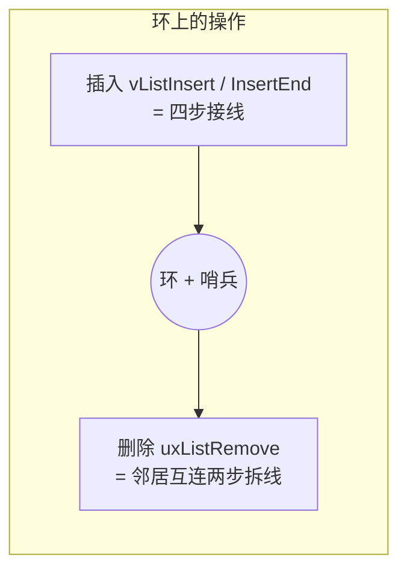

# FreeRTOS list 学习记录（优化版）

> 本笔记基于 **FreeRTOS Kernel V11.3.0** 的 `list.c` / `list.h` 逐行核对整理。
> 配套笔记：`task.md`（tasks.c 全模块精解）——链表是它的地基，建议按 list → task 顺序阅读。

------

[TOC]

------

## 0. 一句话总纲（先读这个）

> FreeRTOS 链表 = **循环双向链表 + 哨兵节点**。
> - **哨兵**：环上永远存在、不存数据、只当边界的"锚点"。
> - **`pxIndex`**：遍历游标 + `vListInsertEnd` 插入锚点。
> - **`xItemValue`**：排序键，链表按它升序排列，调用者维护。
> - **`pxContainer`**：归属标记，`NULL` = 游离，删除时 O(1) 反查。

把这四个角色记住，整个 list 就通了。后面所有代码都是"**在环上接线/拆线**"。

**为什么 RTOS 内核这么依赖它**：`tasks.c` 里"任务的状态"不是用状态变量记录的，而是**用"你挂在哪条链表上"来表达的**——在就绪链表 = Ready，在延时链表 = Blocked，在挂起链表 = Suspended。所以把 list 吃透，tasks.c 的调度逻辑就读懂了一半。

------

## 1. 数据结构

> `list.h` 核心类型（省略完整性校验等可选字段，用 `...` 表示）。

```c
/* 完整版节点：真实节点用 */
struct xLIST_ITEM
{
    ...
    configLIST_VOLATILE TickType_t xItemValue;          /* 排序键 */
    struct xLIST_ITEM * configLIST_VOLATILE pxNext;     /* 下一个节点 */
    struct xLIST_ITEM * configLIST_VOLATILE pxPrevious; /* 上一个节点 */
    void * pvOwner;                                     /* 拥有者(通常是 TCB) */
    struct xLIST * configLIST_VOLATILE pxContainer;     /* 所属链表 */
    ...
};
typedef struct xLIST_ITEM ListItem_t;

/* 精简版节点：哨兵用，省 pvOwner/pxContainer 两个指针 */
struct xMINI_LIST_ITEM
{
    ...
    configLIST_VOLATILE TickType_t xItemValue;
    struct xLIST_ITEM * configLIST_VOLATILE pxNext;
    struct xLIST_ITEM * configLIST_VOLATILE pxPrevious;
    ...
};
typedef struct xMINI_LIST_ITEM MiniListItem_t;

/* 链表本体 */
typedef struct xLIST
{
    ...
    configLIST_VOLATILE UBaseType_t uxNumberOfItems;    /* 真实节点计数(不含哨兵) */
    ListItem_t * configLIST_VOLATILE pxIndex;           /* 遍历游标 */
    MiniListItem_t xListEnd;                            /* 哨兵(精简版) */
    ...
} List_t;
```

### 1.1 关键字段速查

| 字段                    | 所在结构     | 作用                                               |
| ----------------------- | ------------ | -------------------------------------------------- |
| `uxNumberOfItems`       | `List_t`     | 真实节点计数（不含哨兵），O(1) 取长度              |
| `pxIndex`               | `List_t`     | 遍历游标 + `vListInsertEnd` 插入锚点，初始指向哨兵 |
| `xListEnd`              | `List_t`     | 哨兵（精简版），值最大、自环表示空表               |
| `xItemValue`            | 节点         | **排序键**，链表按它升序排列，调用者维护           |
| `pxNext` / `pxPrevious` | 节点         | 双向链表结构线                                     |
| `pvOwner`               | `ListItem_t` | 拥有者（如 TCB 指针），业务用                      |
| `pxContainer`           | `ListItem_t` | 所属链表，`NULL` = 游离，删除时反查用              |

> **V11 新变化 `configUSE_MINI_LIST_ITEM`**：V11 起哨兵是否用精简版变得**可配置**（默认 1 = 用精简版省内存）。若设为 0，`xListEnd` 会退化为完整版 `ListItem_t`（`MiniListItem_t` 被 typedef 成 `ListItem_t`），哨兵的 `pvOwner`/`pxContainer` 在 `vListInitialise` 里被显式置 `NULL`。这是为了照顾某些内核感知调试器和 MISRA 一致性检查。**对理解原理无影响**，读 V10 老教程的人也不用慌。

### 1.2 为什么定义两个节点类型

| 类型                       | 字段                                       | 用途                           |
| -------------------------- | ------------------------------------------ | ------------------------------ |
| `ListItem_t`（完整版）     | 值 + next/prev + `pvOwner` + `pxContainer` | 真实节点，记录拥有者和归属链表 |
| `MiniListItem_t`（精简版） | 值 + next/prev                             | 哨兵专用，**省 2 个指针内存**  |

> FreeRTOS 里链表极多（每个任务带 2 个节点、每条就绪链表带 1 个哨兵、每个队列/信号量都有等待链表……），省这点内存累积起来很可观。
>
> `pxIndex` 必须声明为 `ListItem_t *`（要指向真实节点），初始指向哨兵时靠**强转**——因为两者**前几个字段内存布局一致**（排序键 + 两个方向指针），游标只访问这些公共字段，不碰精简版没有的 `pvOwner`/`pxContainer`。这是 C 语言常见的"**结构体前缀兼容**"技巧。
>
> 补充一个细节：即使开了 `configUSE_LIST_DATA_INTEGRITY_CHECK_BYTES`（完整性校验字节），校验字段在两种结构体里的位置也一致，前缀兼容依然成立。

### 1.3 核心宏（省略注释）

```c
#define listSET_LIST_ITEM_OWNER( pxListItem, pxOwner )    ( ( pxListItem )->pvOwner = ( void * ) ( pxOwner ) )
#define listGET_LIST_ITEM_OWNER( pxListItem )             ( ( pxListItem )->pvOwner )
#define listSET_LIST_ITEM_VALUE( pxListItem, xValue )     ( ( pxListItem )->xItemValue = ( xValue ) )
#define listGET_LIST_ITEM_VALUE( pxListItem )             ( ( pxListItem )->xItemValue )

#define listGET_ITEM_VALUE_OF_HEAD_ENTRY( pxList )        ( ( ( pxList )->xListEnd ).pxNext->xItemValue )
#define listGET_HEAD_ENTRY( pxList )                      ( ( ( pxList )->xListEnd ).pxNext )
#define listGET_NEXT( pxListItem )                        ( ( pxListItem )->pxNext )
#define listGET_END_MARKER( pxList )                      ( ( ListItem_t const * ) ( &( ( pxList )->xListEnd ) ) )

#define listLIST_IS_EMPTY( pxList )                       ( ( ( pxList )->uxNumberOfItems == ( UBaseType_t ) 0 ) ? pdTRUE : pdFALSE )
#define listCURRENT_LIST_LENGTH( pxList )                 ( ( pxList )->uxNumberOfItems )

#define listGET_OWNER_OF_HEAD_ENTRY( pxList )             ( ( &( ( pxList )->xListEnd ) )->pxNext->pvOwner )
#define listIS_CONTAINED_WITHIN( pxList, pxListItem )     ( ( ( pxListItem )->pxContainer == ( pxList ) ) ? ( pdTRUE ) : ( pdFALSE ) )
#define listLIST_ITEM_CONTAINER( pxListItem )             ( ( pxListItem )->pxContainer )
#define listLIST_IS_INITIALISED( pxList )                 ( ( pxList )->xListEnd.xItemValue == portMAX_DELAY )
```

> **读宏的小技巧**：`listGET_HEAD_ENTRY` 取的是 `xListEnd.pxNext`，即**逻辑表头**；`listGET_END_MARKER` 取的是哨兵地址本身，当**遍历终止条件**用。`tasks.c` 里大量出现 `for( pxIterator = listGET_HEAD_ENTRY(pxList); pxIterator != listGET_END_MARKER(pxList); pxIterator = listGET_NEXT(pxIterator) )` 这种"从表头走到哨兵"的标准遍历写法，先在这里混个眼熟。

> **task.c 里的三个"别名"宏**（`list.h` 定义，`tasks.c` 高频使用，读 task 笔记前必须认识）：

```c
#define listINSERT_END( pxList, pxListItem )      vListInsertEnd( ( pxList ), ( pxListItem ) )   /* 尾插(挂到pxIndex前) */
#define listINSERT_SORTED( pxList, pxListItem )   vListInsert( ( pxList ), ( pxListItem ) )      /* 按值排序插入 */
#define listREMOVE_ITEM( pxListItem )             uxListRemove( ( pxListItem ) )                 /* 摘除节点 */
```

> 它们只是换了名字的函数调用。`tasks.c` 里的 `listINSERT_END( &pxReadyTasksLists[prio], &pxTCB->xStateListItem )`、`listREMOVE_ITEM( &pxTCB->xStateListItem )` 全部对应本文第 4、5 章的函数。

### 1.4 轮转遍历宏（单核版）

> `pxIndex` 往后走一步，遇到哨兵就绕回真正的表头，然后取 `pvOwner`。

```c
#if ( configNUMBER_OF_CORES == 1 )
    #define listGET_OWNER_OF_NEXT_ENTRY( pxTCB, pxList )                                       \
    do {                                                                                       \
        List_t * const pxConstList = ( pxList );                                               \
        ( pxConstList )->pxIndex = ( pxConstList )->pxIndex->pxNext;                           \
        if( ( void * ) ( pxConstList )->pxIndex == ( void * ) &( ( pxConstList )->xListEnd ) ) \
        {                                                                                      \
            ( pxConstList )->pxIndex = ( pxConstList )->xListEnd.pxNext;                       \
        }                                                                                      \
        ( pxTCB ) = ( pxConstList )->pxIndex->pvOwner;                                         \
    } while( 0 )
#endif
```

> **这个宏是 FreeRTOS 时间片轮转的心脏**：每次上下文切换时对就绪链表调一次，`pxIndex` 依次往后挪，同优先级的任务就轮流上台。遇到哨兵自动跳过（绕回表头），所以哨兵永远不会被"选中运行"。
>
> 它还有一个重要副作用：**`vListInsertEnd` 把新节点插在 `pxIndex` 前，正好是"下一次轮转最后才轮到"的位置**——这两者配合，才有了 FIFO 公平语义。第 4 章会再强调。

------

## 2. 链表的初始化

### 2.1 代码（精华版）

```c
void vListInitialise( List_t * const pxList )
{
    /* 游标指向哨兵 */
    pxList->pxIndex = ( ListItem_t * ) &( pxList->xListEnd );

    /* 哨兵值设为最大，保证排序时永远垫底 */
    pxList->xListEnd.xItemValue = portMAX_DELAY;

    /* 哨兵首尾自指，形成自环 = 空表 */
    pxList->xListEnd.pxNext = ( ListItem_t * ) &( pxList->xListEnd );
    pxList->xListEnd.pxPrevious = ( ListItem_t * ) &( pxList->xListEnd );

    /* 节点计数归零 */
    pxList->uxNumberOfItems = ( UBaseType_t ) 0U;

    /* ... 完整性校验、configUSE_MINI_LIST_ITEM==0 时哨兵 owner/container 置 NULL 等可选操作省略 ... */
}
```

### 2.2 逐行理解

**① `pxList->pxIndex = ( ListItem_t * ) &( pxList->xListEnd );`**

```
pxList->pxIndex = ( ListItem_t * ) &( pxList->xListEnd );
└──┬──┘ └──┬──┘   └─────┬─────┘   └────────┬────────┘
  链表    游标字段      强制类型转换        取哨兵的地址
```

> **`pxIndex` 是遍历游标**，也是 `vListInsertEnd` 的插入锚点。
>
> - 游标**不能为 NULL**，必须始终指向有效节点。空表时没有真实节点，就指向**永远存在的哨兵**。
> - `pxIndex` 是完整版指针，`xListEnd` 是精简版，类型不匹配 → **强转**（前缀布局兼容，只访问公共字段，安全）。

**② `pxList->xListEnd.xItemValue = portMAX_DELAY;`**

> 哨兵值设为**最大可能值**，保证按值升序排列时**永远垫底**，稳居逻辑表尾。
>
> 关键原因：`vListInsert` 的排序循环条件是 `pxIterator->pxNext->xItemValue <= xValueOfInsertion`。若哨兵值不是最大，新节点值可能 ≥ 哨兵值，循环会越过哨兵继续绕环，**永远停不下来**。哨兵值最大，保证任何真实节点值都 ≤ 哨兵值，循环走到哨兵前一定停住。

**③④ `xListEnd.pxNext` / `pxPrevious` 指向自己**

> 形成**自环**，表示"空表"：

```
        ┌──────────────────┐
        │                  │
        ▼                  │
   ┌──────────┐            │
   │ xListEnd │────────────┘   pxNext 指自己
   │  (哨兵)  │────────────┐
   └──────────┘            │
        ▲                  │
        └──────────────────┘   pxPrevious 指自己
        ▲
        │
     pxIndex ──► 指向哨兵（第①行设置）
```

> 好处：空表遍历不会 NULL 崩溃；插入/删除不用特判空表/头尾；`pxIndex` 永远有效。
>
> **自环不是死循环**！遍历有终止条件（遇到哨兵就停），自环只是"空表"的标准表示。

**⑤ `uxNumberOfItems = 0`**

> 节点计数归零。**不包含哨兵**，只数真实节点。

### 2.3 哨兵的作用（核心理解）

> **哨兵是一个"永远存在、不存数据、只当边界"的假节点。**

- 它是环上的**接缝/锚点**，**既不是头也不是尾**。
- **逻辑表头** = `xListEnd.pxNext`
- **逻辑表尾** = `xListEnd.pxPrevious`
- 只有**空表**时，头尾才退化成哨兵自己（自环）。

**哨兵消除的特判**：

| 场景           | 没有哨兵要写的特判             | 有哨兵后                                |
| -------------- | ------------------------------ | --------------------------------------- |
| 空表遍历       | `if (head == NULL) return;`    | 从 `pxIndex->pxNext` 开始，绕回哨兵即止 |
| 插入到末尾     | 判断是不是最后一个，特殊改指针 | 插在 `pxIndex` 前，空表非空表同一套四步 |
| 删除唯一节点   | 判空、改 head 指针             | 邻居互连两行搞定，空表时邻居就是哨兵    |
| 找"最后一个"   | 遍历到尾再判                   | `xListEnd.pxPrevious` 直接就是          |
| 排序插入防越界 | 判 `next == NULL`              | `xListEnd` 值设为最大，循环永远能停     |

> 哨兵不是为了功能，是为了让代码**简单、无分支、实时性确定**（RTOS 最怕不可预测的分支和耗时）。

### 2.4 初始化后的完整图景

```
List_t
├── uxNumberOfItems = 0            ← 空表
├── pxIndex ─────────────┐
└── xListEnd (哨兵 E)     │
    ├── xItemValue = MAX │         ← 排序时永远垫底
    ├── pxNext ───┐      │
    └── pxPrevious┘◄─────┘         ← 自环
         │
         └──► &E（自己）
```

### 2.5 小结

> `vListInitialise` 把链表初始化为**空表**：游标指向哨兵、哨兵值最大、哨兵首尾自指（自环）、计数清零。三行指针操作配合，构成"**游标有效 + 空环完整**"的初始状态。

------

## 3. 节点的初始化

### 3.1 代码（精华版）

```c
void vListInitialiseItem( ListItem_t * const pxItem )
{
    /* 标记节点不属于任何链表 */
    pxItem->pxContainer = NULL;

    /* ... 完整性校验等可选操作省略 ... */
}
```

### 3.2 理解

**`pxItem->pxContainer = NULL;`**

> 把节点标记为**游离状态——不属于任何链表**。

- `pxContainer` 记录"我挂在哪条链表上"：`NULL` = 游离，`pxList` = 已挂载。
- **为什么必须置 NULL（防御性初始化）**：
  1. 节点内存初始是垃圾值，不置 NULL 后续删除会拿**野指针**访问链表，崩溃或踩内存。
  2. NULL 是"游离"的**唯一标准表示**，所有代码靠它判断节点是否在链表上（`vTaskDelete`、`eTaskGetState` 等都靠 `listLIST_ITEM_CONTAINER()` 判 NULL）。
  3. 节点可复用：插入→删除→再插入，状态始终干净。

> **注意**：这个函数**不初始化** `pxNext`/`pxPrevious`/`xItemValue`。前者插入时才设，后者是用户数据（排序键），FreeRTOS 不该替用户覆盖。

### 3.3 节点的完整生命周期

```c
ListItem_t xItem;

vListInitialiseItem( &xItem );   // ① pxContainer = NULL，游离
xItem.xItemValue = 42;           // ② 用户设排序键
vListInsert( &xList, &xItem );   // ③ pxContainer = &xList，挂载；四步接线
// ... 节点在链表里 ...
uxListRemove( &xItem );          // ④ pxContainer = NULL，回到游离
```

> 在 `tasks.c` 里，一个任务天生带两个节点（`xStateListItem` 状态节点 + `xEventListItem` 事件节点），创建时双双走一遍这个生命周期。**同一个节点同一时刻只能在一条链表上**——所以一个任务的"状态节点"和"事件节点"可以同时挂在两条不同的链表上（"一脚踏两船"），这是 task.md 模块 8 的核心戏码。

### 3.4 小结

> `vListInitialiseItem` 把节点标记为**游离**，让它处于可安全插入的初始状态。它不填数据、不连指针，那些是后续 `vListInsert` 和用户的事。

------

## 4. 插入节点

FreeRTOS 有两种插入：`vListInsertEnd`（固定插表尾）和 `vListInsert`（按值排序插入）。**两者改的四根线完全相同**，只是找位置方式和排列顺序不同。

### 4.0 先记住四根线

任何插入，本质都是把新节点 N 塞进"锚点 A"和"锚点后继 B"之间：

```
插入前：  A ⇄ B
插入后：  A ⇄ N ⇄ B
```

需要改的四根线：**N.next、N.prev、A.next、B.prev**。

**唯一的硬约束**：**先读旧后继（B），再改 A.next**。否则 A.next 被覆盖后，就找不到 B 了。

### 4.1 `vListInsertEnd` —— 插到 `pxIndex` 前（等价于表尾）

```c
void vListInsertEnd( List_t * const pxList, ListItem_t * const pxNewListItem )
{
    ListItem_t * const pxIndex = pxList->pxIndex;

    /* 四步插入：把新节点插到 pxIndex 前面 */
    pxNewListItem->pxNext = pxIndex;                    // ① N.next = 后继
    pxNewListItem->pxPrevious = pxIndex->pxPrevious;    // ② N.prev = 前驱

    pxIndex->pxPrevious->pxNext = pxNewListItem;        // ③ 前驱.next = N
    pxIndex->pxPrevious = pxNewListItem;                // ④ 后继.prev = N

    /* 记录所属链表，计数 +1 */
    pxNewListItem->pxContainer = pxList;
    ( pxList->uxNumberOfItems ) = ( UBaseType_t ) ( pxList->uxNumberOfItems + 1U );
}
```

**四步图解**（把 N 插到 A 和 B 之间，`pxIndex = B`，原 `B.pxPrevious = A`）：

| 步   | 代码                                 | 改谁的指针 | 改前 | 改后                               |
| ---- | ------------------------------------ | ---------- | ---- | ---------------------------------- |
| 1    | `N.pxNext = pxIndex`                 | 新节点 N   | 垃圾 | B                                  |
| 2    | `N.pxPrevious = pxIndex->pxPrevious` | 新节点 N   | 垃圾 | A（**必须此时读，第 4 步会覆盖**） |
| 3    | `pxIndex->pxPrevious->pxNext = N`    | 前驱 A     | B    | N                                  |
| 4    | `pxIndex->pxPrevious = N`            | 后继 B     | A    | N                                  |

> **口诀**：先让新人（N）认识前后邻居（1、2），再让邻居认新人（3、4）。
>
> **易错点**：第 3、4 步左值不同——`pxIndex->pxPrevious->pxNext` 改的是 **A 的 pxNext**；`pxIndex->pxPrevious` 改的是 **B 的 pxPrevious**。多一层 `->` 就多跳一个节点。
>
> **顺序约束**：必须先做第 2 步再做第 4 步，因为第 4 步会把 `B.pxPrevious` 从 A 改成 N，之后就找不到 A 了。

**空表也成立**：空表时 `pxIndex = &xListEnd`，`xListEnd.pxPrevious = &xListEnd`（自环），代入四步得到 `E ⇄ N ⇄ E`，天然成立，**不需要特判空表**。

**语义（重点）**：它的准确语义是**"把 N 插在 `pxIndex` 前面"**，让 N 成为 `listGET_OWNER_OF_NEXT_ENTRY()` **最后**才会遍历到的节点。由于内核使用中 `pxIndex` 几乎总停在哨兵上（每次遍历宏都会把它挪走又绕回），**实际效果 = 插在逻辑表尾 = FIFO**。就绪列表用它实现同优先级任务的**轮转公平**。这也是它名字里叫 `End` 的由来——不是"插到哨兵后面"，而是"成为逻辑上的最后一个"。

### 4.2 `vListInsert` —— 按值排序插入

```c
void vListInsert( List_t * const pxList, ListItem_t * const pxNewListItem )
{
    ListItem_t * pxIterator;
    const TickType_t xValueOfInsertion = pxNewListItem->xItemValue;

    /* ① 找插入位置 */
    if( xValueOfInsertion == portMAX_DELAY )
    {
        /* 特判：直接插表尾，防死循环 */
        pxIterator = pxList->xListEnd.pxPrevious;
    }
    else
    {
        /* 从哨兵出发，找到"最后一个值 <= 新值的节点" */
        for( pxIterator = ( ListItem_t * ) &( pxList->xListEnd );
             pxIterator->pxNext->xItemValue <= xValueOfInsertion;
             pxIterator = pxIterator->pxNext )
        {
            /* 空循环，只找位置 */
        }
    }

    /* ② 四步插入（前驱是 pxIterator） */
    pxNewListItem->pxNext = pxIterator->pxNext;         // ① N.next = 后继
    pxNewListItem->pxNext->pxPrevious = pxNewListItem;  // ② 后继.prev = N
    pxNewListItem->pxPrevious = pxIterator;             // ③ N.prev = 前驱
    pxIterator->pxNext = pxNewListItem;                 // ④ 前驱.next = N

    /* ③ 记录所属链表，计数 +1 */
    pxNewListItem->pxContainer = pxList;
    ( pxList->uxNumberOfItems ) = ( UBaseType_t ) ( pxList->uxNumberOfItems + 1U );
}
```

**`pxIterator` 是什么**：插入锚点（前驱节点）。找位置阶段让它停在"最后一个值 ≤ 新值的节点"上，四步插入时它就是前驱。

**找位置逻辑**：

- 从哨兵出发往后走，只要下一个节点的值 ≤ 新值就继续走，停在"最后一个值 ≤ 新值的节点"上，新节点插它后面。
- 例：链表 `[10, 20, 30]` 插入 `25` → 停在 20，结果 `10 → 20 → 25 → 30`。

**两个关键细节**：

1. **`<=` 而不是 `<`**：相同值时新节点插在已有节点**后面**。就绪列表里同优先级任务值相同，新任务插后面，**大家轮流分享 CPU**，实现公平调度。
2. **`portMAX_DELAY` 特判**：哨兵值也是 `portMAX_DELAY`，若新值等于最大值，`<=` 条件对哨兵也成立，循环会**死循环**。所以直接定位到 `xListEnd.pxPrevious`，跳过循环。

> 那段大注释是在提醒："如果代码卡死在这里，常见原因是栈溢出、中断优先级配置错误、在临界区/挂起调度器时调用 API、队列/信号量未初始化就用、tick 中断优先级过高"——本质是**调用者违反了 FreeRTOS 使用规则**导致链表被踩坏。源码里的空 `for` 循环体上方就写着一行大写提示：`IF YOU FIND YOUR CODE STUCK HERE, SEE THE NOTE JUST ABOVE.`

### 4.3 四步顺序对比（重要）

|       | `vListInsertEnd`        | `vListInsert`                         |
| ----- | ----------------------- | ------------------------------------- |
| 第1步 | N.next = 后继           | N.next = 后继                         |
| 第2步 | N.prev = 前驱           | **后继.prev = N**                     |
| 第3步 | **前驱.next = N**       | N.prev = 前驱                         |
| 第4步 | **后继.prev = N**       | **前驱.next = N**                     |
| 风格  | 先设完 N 两根，再改邻居 | N.next → 邻居 → N.prev → 邻居（交替） |

> **改的四根线完全一样**（N.next、N.prev、前驱.next、后继.prev），只是**排列顺序不同**。
>
> 唯一硬约束是"**先读旧后继，再改前驱.next**"，只要满足它，四步怎么排都对。两种写法功能等价，只是代码风格/历史原因不同。

### 4.4 两种插入对比

|          | `vListInsertEnd`              | `vListInsert`                          |
| -------- | ----------------------------- | -------------------------------------- |
| 插入位置 | 固定插在 `pxIndex` 前（表尾） | 按 `xItemValue` **升序**找位置         |
| 找位置   | 不需要，O(1)                  | for 循环遍历，O(n)，n = 链上节点数     |
| 特殊处理 | 无                            | 值 == `portMAX_DELAY` 特判，防死循环   |
| 相同值   | 插在 `pxIndex` 前             | 插在已有相同值**后面**（`<=`），保公平 |
| 典型用途 | 就绪列表（FIFO 轮转）         | 延时列表（按唤醒时间排序）、事件等待表（按优先级排序） |

### 4.5 完整示例：`E ⇄ A ⇄ E` 插入 N

只有一个真实节点 A，环是 `E ⇄ A ⇄ E`：

| 节点      | `pxNext` | `pxPrevious` |
| --------- | -------- | ------------ |
| E（哨兵） | A        | A            |
| A         | E        | E            |

**想插在 A 前**（锚点 = E）：四步后 → `E ⇄ N ⇄ A ⇄ E`，N 成**逻辑表头**。
**想插在 A 后**（锚点 = A）：四步后 → `E ⇄ A ⇄ N ⇄ E`，N 成**逻辑表尾**。

> 规律：四步永远是"把 N 塞进 `pxIterator` 和 `pxIterator->pxNext` 之间"。锚点选 E，N 成表头；锚点选 A，N 成表尾。

### 4.6 小结

> 插入的本质是**四步指针操作**：改 N.next、N.prev、前驱.next、后继.prev 四根线。`vListInsert` 额外需要先用 `for` 循环（或 `portMAX_DELAY` 特判）找到插入位置。哨兵自环让空表和非空表共用同一套插入逻辑。

------

## 5. 删除节点

### 5.1 代码（精华版）

```c
UBaseType_t uxListRemove( ListItem_t * const pxItemToRemove )
{
    /* ① 从节点反查所属链表 */
    List_t * const pxList = pxItemToRemove->pxContainer;

    /* ②③ 让前后邻居互连（跳过自己） */
    pxItemToRemove->pxNext->pxPrevious = pxItemToRemove->pxPrevious;
    pxItemToRemove->pxPrevious->pxNext = pxItemToRemove->pxNext;

    /* ④ 修正游标，防止悬空 */
    if( pxList->pxIndex == pxItemToRemove )
    {
        pxList->pxIndex = pxItemToRemove->pxPrevious;
    }

    /* ⑤⑥ 标记游离 + 计数 -1 */
    pxItemToRemove->pxContainer = NULL;
    ( pxList->uxNumberOfItems ) = ( UBaseType_t ) ( pxList->uxNumberOfItems - 1U );

    return pxList->uxNumberOfItems;
}
```

### 5.2 逐行理解

**① 从节点反查链表**

> 靠 `pxContainer`（插入时记录的"我属于哪条链表"），节点自己就知道链表在哪，**不需要调用者传链表指针**。这就是记录 `pxContainer` 的价值——O(1) 快速反查。这也解释了为什么函数签名里只有节点没有链表。

**②③ 让前后邻居互连（核心两步）**

被删节点 `X` 的前驱 `P`、后继 `N`：

```
删除前：  P ◄──► X ◄──► N
删除后：  P ◄────────► N     （X 被跳过）
```

- `N->pxPrevious = P`：后继的前驱改成 P。
- `P->pxNext = N`：前驱的后继改成 N。

> **循环链表的好处**：`P` 和 `N` 永远存在（空表时哨兵自环，删最后一个真实节点时 P、N 都是哨兵），**不需要判空、不需要特判头尾**，两行通吃所有情况。
>
> **左值 vs 右值**：`pxItemToRemove->pxNext->pxPrevious` 先算出后继 N 的地址，再定位 N 的 `pxPrevious` 字段写入；`pxItemToRemove->pxPrevious` 是读前驱 P 的地址当右值。多一层 `->` 就多跳一个节点。

**④ 修正 pxIndex**

> 若游标正好指向被删节点，就挪到被删节点的**前驱**，保证 `pxIndex` 永远指向有效节点、不悬空。

**⑤⑥ 清理 + 计数**

> - `pxContainer = NULL`：恢复"游离"状态，节点可再次插入别的链表。
> - 计数减一。
>
> **注意**：函数**不清** `pxNext`/`pxPrevious`。节点已摘除，这两个指针是脏数据但没人用（下次插入会被覆盖），清它们反而多开销。**已删除节点别再去读它的 next/previous**。

### 5.3 删除示意

```
删除前：
    ┌───┐      ┌───┐      ┌───┐
    │ P │◄────►│ X │◄────►│ N │
    └───┘      └───┘      └───┘
                 ▲
              pxIndex（假如指向 X）

删除后：
    ┌───┐               ┌───┐
    │ P │◄─────────────►│ N │
    └───┘               └───┘
       ▲
    pxIndex 挪到这里（X 的前驱 P）

    X: pxContainer = NULL（游离）
```

### 5.4 小结

> `uxListRemove` 利用节点自带的 `pxContainer` 反查链表，让**前驱和后继直接互连**（2 根线）把节点摘除；循环链表保证无需特判边界；若 `pxIndex` 正好指向被删节点则挪到其前驱防悬空；最后 `pxContainer` 置 NULL、计数减一，返回剩余节点数。核心就是"**邻居跳过自己**"。

------

## 6. 插入与删除对比 + 复杂度速查

|            | 插入                       | 删除                         |
| ---------- | -------------------------- | ---------------------------- |
| 改几根线   | 4 根                       | 2 根（邻居互连）             |
| 需要找位置 | 是（`vListInsert` 要遍历） | 否（节点自带 `pxContainer`） |
| 特判       | `portMAX_DELAY` 防死循环   | `pxIndex` 是否指向被删节点   |
| 计数       | +1                         | -1                           |
| 返回       | void                       | 剩余节点数                   |

**时间复杂度一览**（这也是内核敢把链表当状态机用的底气）：

| 操作                                       | 复杂度        | 说明                                     |
| ------------------------------------------ | ------------- | ---------------------------------------- |
| `vListInitialise` / `vListInitialiseItem`  | O(1)          | 纯赋值                                   |
| `vListInsertEnd`                           | O(1)          | 不找位置，四步接线                       |
| `vListInsert`                              | **O(n)**      | 要按值找位置；延时表按唤醒时间有序故插入 |
| `uxListRemove`                             | O(1)          | 靠 `pxContainer` 反查，邻居互连          |
| `listGET_OWNER_OF_NEXT_ENTRY`              | O(1)          | 游标走一步                               |
| `listGET_OWNER_OF_HEAD_ENTRY` / 取表长等   | O(1)          | 直接读字段                               |

> 唯一的 O(n) 是排序插入，而它最重的用途（延时表）里链表按唤醒时间有序、且 tick 到期时**只从表头摘**，整体依然高效。

------

## 7. 整体理解：环 + 哨兵

FreeRTOS 链表 = **循环双向链表 + 哨兵节点**。建立这个心智模型后，所有指针操作都是"**在环上接线/拆线**"：

- **插入** = 往环里加一节；
- **删除** = 从环里摘一节；
- **哨兵** = 环上永远不动的那节"锚点"。



**防晕三问**（看链表代码时先问自己）：

1. **现在环里有几个节点？**（空表 = 只有哨兵且自环）
2. **我要操作的位置在哪？**（哨兵前 / 某个节点后 / 找值）
3. **改线时，先读的旧值读到了吗？**（四步插入的顺序约束）

**关键概念澄清**：

- 哨兵**不是头也不是尾**，是接缝。逻辑表头 = `xListEnd.pxNext`，逻辑表尾 = `xListEnd.pxPrevious`。
- 自环**不是死循环**，是"空表"的标准表示，遍历遇到哨兵就停。
- `xItemValue` 是**排序键**，链表只读不写，由调用者维护；哨兵值设为最大保证排序循环不死循环。
- **两种插入四步顺序不同，但改的四根线完全一样**，只要满足"先读旧后继，再改前驱.next"就等价。

------

## 8. 与 tasks.c 的衔接（学完 list 看这里再进 task）

链表机制本身只有 4 个函数 + 一堆宏，但它被 `tasks.c` 用出了两种"语义"。提前知道这两点，读 task 笔记时不会懵：

**① 同一个 `xItemValue` 字段，两种含义（由调用者赋值）**：

| 挂在哪条链表               | `xItemValue` 存什么            | 插入方式          | 排序效果                     |
| -------------------------- | ------------------------------ | ----------------- | ---------------------------- |
| 状态链表（就绪/延时/挂起） | **唤醒时刻**（Tick 绝对时间）  | `vListInsert`     | 延时表按"谁先醒"升序         |
| 状态链表（就绪表）         | 无所谓（FIFO，不按它排序）     | `vListInsertEnd`  | 同优先级任务排队轮转         |
| 事件链表（队列等待表等）   | **`configMAX_PRIORITIES - 优先级`** | `vListInsert` | 值越小 = 优先级越高 → 排最前 |

> 注意事件表的"补数"技巧：`vListInsert` 是**升序**排列，而我们要"优先级最高的排最前"，于是存 `MAX - 优先级` 把大小关系倒过来。这解释了 TCB 里为什么有两个 `ListItem_t`：**状态节点**管"你现在睡到几点/排哪个队"，**事件节点**管"你在等的事件里你排第几"。

**② `listGET_OWNER_OF_NEXT_ENTRY` 就是时间片轮转**：

每次上下文切换，内核选出最高优先级的就绪链表后，对该链表调一次这个宏——`pxIndex` 后移一格取任务。同优先级有 3 个任务时，三次切换正好各轮到一次，这就是"时间片轮转"的全部实现，没有任何额外代码。

**③ SMP 构建下的两个小变化（读 task 笔记延伸篇 B 前的预告）**：

V11.3 的 SMP 构建（`configNUMBER_OF_CORES > 1`）改变了 tasks.c"怎么用链表"，链表本身一寸没改：

| 变化点 | 单核（前文视角） | SMP 构建 |
| ------ | ---------------- | -------- |
| 运行任务在不在就绪表 | 在（游标轮转依赖它） | 也在；但扫描选人时，挂在**别的核**上跑的候选会被跳过 |
| 同优先级下一个跑谁 | `listGET_OWNER_OF_NEXT_ENTRY` 游标后移 | 改为显式扫描 + 选人前把本核当前任务挪到队尾 |

> 结论：链表四件套的用法不变，变的只是 tasks.c 怎么"点名"。多核部分详见 task 笔记延伸篇 B。

------

## 9. 附：易混淆点速查

| 易混点                           | 澄清                                                         |
| -------------------------------- | ------------------------------------------------------------ |
| `pxIndex` vs `pxIterator`        | `pxIndex` 是链表**成员**（永久游标）；`pxIterator` 是 `vListInsert` 的**局部变量**（临时锚点，用完即弃） |
| `pxIndex->pxPrevious` 在第3、4步 | 第3步它是**跳板**（改 A 的 pxNext）；第4步它是**左值本身**（改 B 的 pxPrevious）。数 `->` 层数判断 |
| 自环 = 死循环？                  | 不是。遍历有终止条件（遇哨兵停），自环只是空表表示           |
| 哨兵是头还是尾？                 | 都不是，是接缝。头 = `xListEnd.pxNext`，尾 = `xListEnd.pxPrevious` |
| 两种插入四步顺序不同？           | 改的四根线相同，只是排列不同，满足"先读后写"约束即等价       |
| 为什么 `<=` 不是 `<`             | 相同值后插，保证同优先级任务公平轮转                         |
| 为什么特判 `portMAX_DELAY`       | 哨兵值也是 MAX，`<=` 对哨兵成立会死循环，直接插表尾          |
| 删除后 next/prev 是脏值          | 刻意不清（省开销），但**不能再读**                           |
| `listINSERT_END` 是新函数？      | 不是，是 `vListInsertEnd` 的别名宏（`tasks.c` 常用）         |
| 精简版哨兵一定存在？             | V11 起由 `configUSE_MINI_LIST_ITEM` 决定，默认 1；设 0 则哨兵是完整节点 |
| `uxNumberOfItems` 含哨兵吗？     | 不含，只数真实节点。`listLIST_IS_EMPTY` 靠它判 0             |


---
*AI生成*
