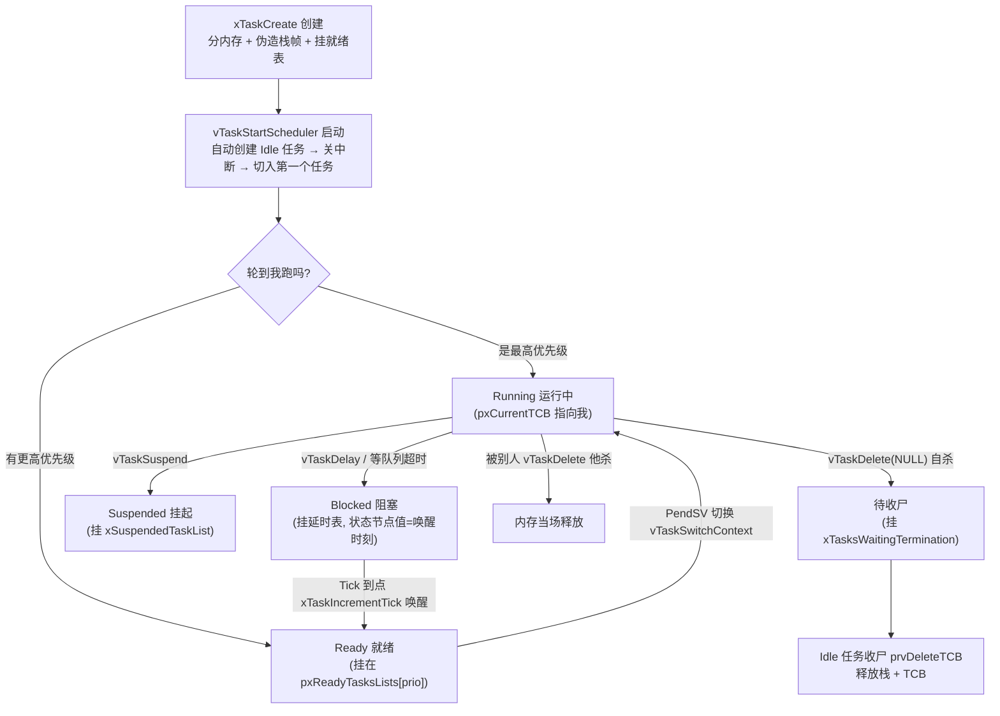
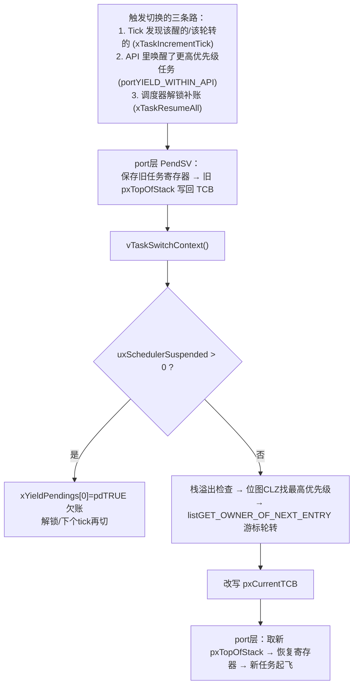
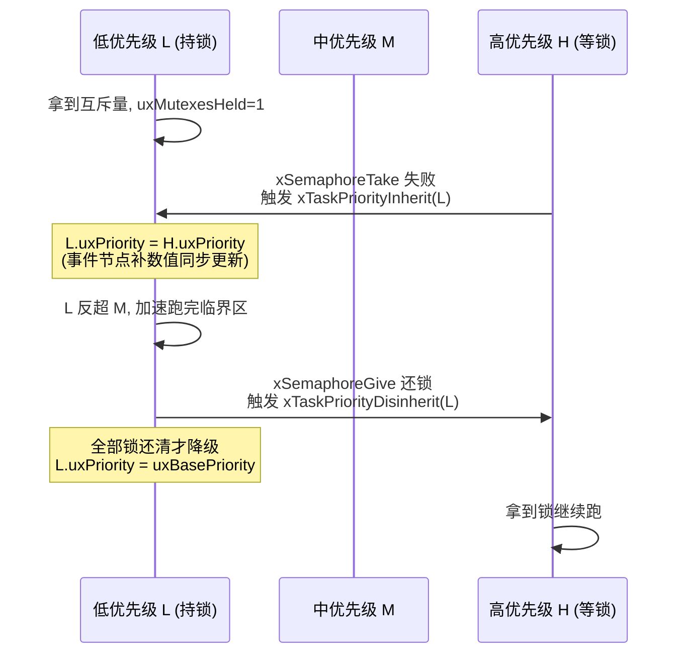
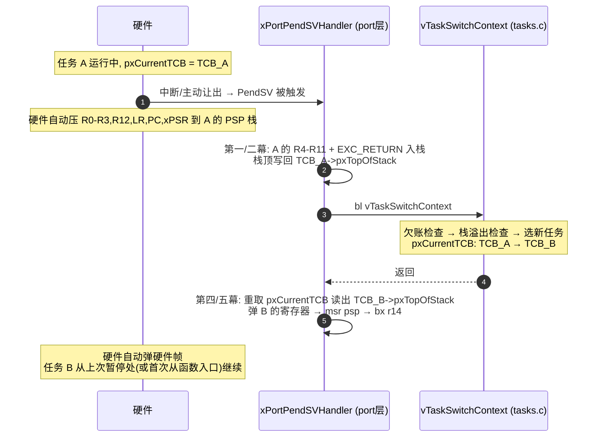
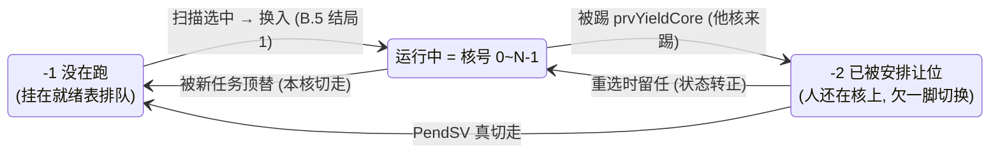
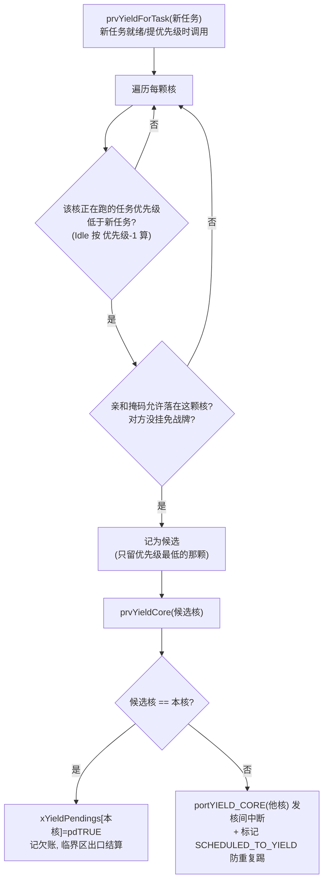
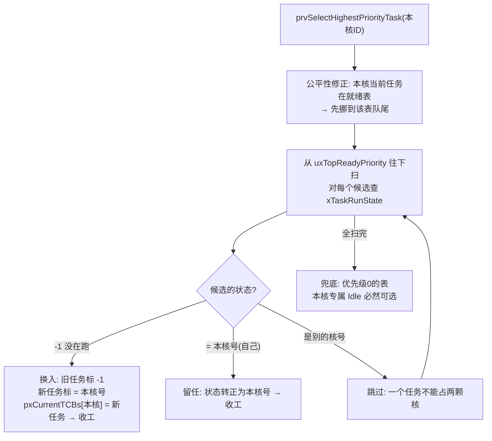

# FreeRTOS tasks.c 终极完整学习笔记（全模块精解·优化版）

> 本笔记基于 **FreeRTOS Kernel V11.3.0** 的 `tasks.c`（8873 行）逐行核对整理。
> 前置知识：`list.md`（链表精解）。tasks.c 的一切"状态"都是链表，请先确认你已理解 `ListItem_t`、`pxContainer`、`vListInsert`/`vListInsertEnd`/`uxListRemove` 四件套。

------

[TOC]

------

## 0. 全局鸟瞰：8000 行 `tasks.c` 到底装了什么？

把多核（SMP）、MPU 内存保护、Trace 调试桩剥掉后，整个 `tasks.c` 由 **12 大核心功能模块** 组成：

| 模块序号    | 模块名称                 | 核心代表函数                                      | 一句话本质                                               |
| :---------- | :----------------------- | :------------------------------------------------ | :------------------------------------------------------- |
| **模块 1**  | **数据结构与全局账本**   | `TCB_t`, `pxReadyTasksLists`                      | 1个身份证 + 6条状态链表 + 1个优先级位图                  |
| **模块 2**  | **任务创建与初始化**     | `xTaskCreate`, `prvInitialiseNewTask`             | 分内存、伪造中断栈帧、挂入就绪表                         |
| **模块 3**  | **调度器启动与空闲任务** | `vTaskStartScheduler`, `prvIdleTask`              | 创建保底的 Idle 任务、关中断、切入第1个任务              |
| **模块 4**  | **延时阻塞与双表防溢出** | `vTaskDelay`, `xTaskDelayUntil`                   | 从就绪表摘除，算唤醒时间，升序插入延时表                 |
| **模块 5**  | **删除、挂起与恢复**     | `vTaskDelete`, `vTaskSuspend`, `vTaskResume`      | 在就绪表、挂起表、待销毁表之间强行挪动节点               |
| **模块 6**  | **心跳节拍与上下文切换** | `xTaskIncrementTick`, `vTaskSwitchContext`        | 查延时表头唤醒到期任务 + 位图 O(1) 选最高优先级          |
| **模块 7**  | **调度器锁与临界区**     | `vTaskSuspendAll`, `xTaskResumeAll`               | 不关硬件中断的轻量级锁，靠 `xPendingReadyList` 记账      |
| **模块 8**  | **事件表桥接与超时计算** | `vTaskPlaceOnEventList`, `xTaskCheckForTimeOut`   | 配合 `queue.c` 实现"一脚踏两船"与防假唤醒剩余时间重算    |
| **模块 9**  | **优先级继承（防翻转）** | `xTaskPriorityInherit`, `xTaskPriorityDisinherit` | 配合互斥量（Mutex），临时拔高/打回低优先级持有者的优先级 |
| **模块 10** | **任务通知与低功耗**     | `xTaskGenericNotify`, `ulTaskGenericNotifyTake`   | 直接往 TCB 里的整数写值发信号，零内存开销，比队列快 45%  |
| **模块 11** | **删除的收尾：收尸**     | `prvCheckTasksWaitingTermination`, `prvDeleteTCB` | Idle 任务代为释放自杀任务的栈和 TCB 内存                 |
| **模块 12** | **优先级动态修改**       | `vTaskPrioritySet`, `eTaskGetState`               | 换优先级 = 换就绪链表；查状态 = 查链表归属               |

> 模块 11、12 是本版新增章节：原笔记只有 `vTaskDelete` 的"挂表"动作，没有内存回收闭环，也没有优先级修改和状态查询——这三块都是面试和读源码的高频区。
>
> **延伸篇 A/B** 超出单核主线：A 讲 tasks.c 与 port 层汇编（PendSV）的交接棒；B 讲开篇"剥掉"的多核 SMP 改造。两者都不推翻单核结论，建议主线读完再看。

------

## 0.5 主线故事：一个任务的一生（先建立时间轴再进细节）

学 tasks.c 最忌一上来就扎进函数。先记住这条主线，每个模块都是这条线上的一站：



对应到代码，一共只有三类动作：

1. **挂表/摘表**（`listINSERT_END` / `listREMOVE_ITEM`）——所有状态变化的本质；
2. **排序键赋值**（`listSET_LIST_ITEM_VALUE`）——延时表存唤醒时刻、事件表存 `MAX-优先级`；
3. **触发调度**（`portYIELD_WITHIN_API()`）——让 PendSV 在最近的时刻执行上下文切换。

读完每个模块后回来看这张图，你会发现全部对得上。

------

## 模块 1：数据结构与全局账本

### 1.1 任务控制块 `TCB_t`（完整核心字段版）

```c
typedef struct tskTaskControlBlock
{
    volatile StackType_t * pxTopOfStack; /* 【铁律：第1个成员】当前任务栈顶指针（汇编直接解引用） */

    ListItem_t xStateListItem;           /* 【肉体节点】挂就绪/延时/挂起/待删链表，xItemValue=唤醒时间 */
    ListItem_t xEventListItem;           /* 【分身节点】挂队列/事件等待链表，xItemValue=MAX_PRIO - 优先级 */
    UBaseType_t uxPriority;              /* 当前生效的优先级（0最低，越大越高） */
    StackType_t * pxStack;               /* 任务栈起始底地址（用于检测栈溢出 & free释放内存） */
    char pcTaskName[ configMAX_TASK_NAME_LEN ]; /* 任务名字 */

    /* --- 临界区嵌套（仅 portCRITICAL_NESTING_IN_TCB==1 的移植层才有此字段） --- */
    UBaseType_t uxCriticalNesting;       /* 临界区嵌套深度计数 */

    /* --- 互斥量与优先级继承专用（configUSE_MUTEXES==1 才有） --- */
    UBaseType_t uxBasePriority;          /* 原始基础优先级（发生优先级继承前备份原优先级） */
    UBaseType_t uxMutexesHeld;           /* 当前任务手头持有了几把互斥锁 */

    /* --- 任务通知专用（直接内置在TCB里的轻量级邮箱，configUSE_TASK_NOTIFICATIONS==1 才有） --- */
    volatile uint32_t ulNotifiedValue[ configTASK_NOTIFICATION_ARRAY_ENTRIES ]; /* 32位通知值数组 */
    volatile uint8_t ucNotifyState[ configTASK_NOTIFICATION_ARRAY_ENTRIES ];    /* 状态：未等/等待中/已收到 */

    /* --- 内存分配标记与延时中止标记 --- */
    uint8_t ucStaticallyAllocated;       /* 标记栈和TCB是静态还是动态分配，决定vTaskDelete时怎么free */
    uint8_t ucDelayAborted;              /* 标记任务的阻塞是否被 xTaskAbortDelay 强行打断 */
} tskTCB;
typedef tskTCB TCB_t;
```

> **两个容易被忽略的点**：
> 1. 真实源码里除 `pxTopOfStack` 外全是 `#if` 条件编译字段（MPU、SMP、TLS、trace……），上表是"最常用配置下的合集"。
> 2. `pxTopOfStack` 必须是第一个成员，因为 Cortex-M 的 PendSV 汇编**直接拿 TCB 指针当栈顶指针的存放地址用**（`ldr r0, =pxCurrentTCB` → `ldr r1, [r0]`），没有任何偏移修正的机会。

### 1.2 全局链表与核心控制变量

```c
/* 1. 全场唯一当前运行任务指针（SMP 下才是数组 pxCurrentTCBs[]） */
TCB_t * volatile pxCurrentTCB = NULL;

/* 2. 六大全局状态链表 */
static List_t pxReadyTasksLists[ configMAX_PRIORITIES ]; /* 就绪表数组：每个优先级一条独立链表 */
static List_t xDelayedTaskList1;                         /* 延时表1 */
static List_t xDelayedTaskList2;                         /* 延时表2（溢出表） */
static List_t * volatile pxDelayedTaskList;              /* 指向当前延时表 */
static List_t * volatile pxOverflowDelayedTaskList;      /* 指向溢出延时表 */
static List_t xPendingReadyList;                         /* 挂起调度器期间，刚刚就绪的任务暂存表 */
static List_t xTasksWaitingTermination;                  /* 自杀任务等待 Idle 任务回收内存的表 */
static List_t xSuspendedTaskList;                        /* 挂起表（vTaskSuspend 或永久阻塞任务） */

/* 3. 全局调度状态变量 */
static volatile UBaseType_t uxCurrentNumberOfTasks = 0U; /* 当前系统总任务数 */
static volatile TickType_t xTickCount = 0U;              /* 系统节拍计数器 */
static volatile UBaseType_t uxTopReadyPriority = 0U;     /* 最高就绪优先级（硬件模式下为32位BitMap） */
static volatile BaseType_t xSchedulerRunning = pdFALSE;  /* 调度器是否已启动标志 */
static volatile UBaseType_t uxSchedulerSuspended = 0U;   /* 调度器挂起嵌套层数（>0则禁止切换） */
static volatile TickType_t xPendedTicks = 0U;            /* 调度器挂起期间漏掉的 Tick 计数 */
static volatile BaseType_t xYieldPendings[ 1 ] = { pdFALSE }; /* 欠一次上下文切换标志 */
static volatile BaseType_t xNumOfOverflows = 0;          /* xTickCount 发生回绕溢出的总次数 */
static volatile TickType_t xNextTaskUnblockTime = 0U;    /* 【闹钟缓存】下一个最早到期任务的唤醒时间 */
static volatile UBaseType_t uxDeletedTasksWaitingCleanUp = 0U; /* 待 Idle 任务收尸的自杀任务数量 */
```

**六条链表的分工一句话版**：

| 链表 | 谁在里面 | 什么时候进去 |
| ---- | -------- | ------------ |
| `pxReadyTasksLists[prio]` | 就绪任务 | 随时可被调度（每优先级一条） |
| `pxDelayedTaskList`（1或2） | 定时阻塞任务 | `vTaskDelay` / 等事件带超时 |
| `pxOverflowDelayedTaskList` | 唤醒时刻会回绕的任务 | 唤醒时刻算出来"小于当前时间" |
| `xPendingReadyList` | 锁调度期间被唤醒的任务 | 中断想唤醒任务但调度器还锁着 |
| `xTasksWaitingTermination` | 自杀了的任务 | 等自己的栈切走后由 Idle 收尸 |
| `xSuspendedTaskList` | 被挂起任务 + **无限期阻塞任务** | `vTaskSuspend` / 等 `portMAX_DELAY` |

> **`uxTopReadyPriority` 的双重身份**（重要）：`configUSE_PORT_OPTIMISED_TASK_SELECTION == 1` 时它是**位图**——第 n 位为 1 表示优先级 n 的就绪表非空（Cortex-M 用 `CLZ` 指令 O(1) 找最高位）；为 0 时它退化成"当前最高就绪优先级的数值"（用比较/递减找）。同一变量两种用法，由这组宏统一封装。

**内存分配三态标记**（模块 2 创建、模块 11 收尸都要用）：

```c
#define tskDYNAMICALLY_ALLOCATED_STACK_AND_TCB    ( ( uint8_t ) 0 ) /* 栈和TCB都是动态分配：收尸时全 free */
#define tskSTATICALLY_ALLOCATED_STACK_ONLY        ( ( uint8_t ) 1 ) /* 栈静态、TCB动态：收尸时只 free TCB */
#define tskSTATICALLY_ALLOCATED_STACK_AND_TCB     ( ( uint8_t ) 2 ) /* 全静态：收尸时什么都不 free */
#define tskSTACK_FILL_BYTE                        ( 0xa5U )         /* 新栈填充字节（水位线检测用） */
```

### 1.3 三大基石宏

```c
/* ① 把任务加入就绪表：位图置 1 + 插到对应优先级链表尾部 */
#define prvAddTaskToReadyList( pxTCB )                                                                     \
    do {                                                                                                   \
        traceMOVED_TASK_TO_READY_STATE( pxTCB );                                                           \
        taskRECORD_READY_PRIORITY( ( pxTCB )->uxPriority ); /* uxTopReadyPriority |= (1 << uxPriority) */  \
        listINSERT_END( &( pxReadyTasksLists[ ( pxTCB )->uxPriority ] ), &( ( pxTCB )->xStateListItem ) ); \
    } while( 0 )

/* ② O(1) 选最高优先级任务：硬件 CLZ 找最高位 + 移动 pxIndex 实现同优先级时间片轮转 */
#define taskSELECT_HIGHEST_PRIORITY_TASK()                                                    \
    do {                                                                                      \
        UBaseType_t uxTopPriority;                                                            \
        portGET_HIGHEST_PRIORITY( uxTopPriority, uxTopReadyPriority );                        \
        listGET_OWNER_OF_NEXT_ENTRY( pxCurrentTCB, &( pxReadyTasksLists[ uxTopPriority ] ) ); \
    } while( 0 )

/* ③ Tick 溢出回绕到 0 时：瞬间交换当前延时表与溢出延时表指针 */
#define taskSWITCH_DELAYED_LISTS()                    \
    do {                                              \
        List_t * pxTemp = pxDelayedTaskList;          \
        pxDelayedTaskList = pxOverflowDelayedTaskList;\
        pxOverflowDelayedTaskList = pxTemp;           \
        xNumOfOverflows++;                            \
        prvResetNextTaskUnblockTime();                \
    } while( 0 )
```

> **② 有两副面孔**：上面是"硬件加速版"（`configUSE_PORT_OPTIMISED_TASK_SELECTION == 1`，配 CLZ）。通用版长这样（性能略差但全平台可用）：
>
> ```c
> /* 通用版：从 uxTopReadyPriority 开始往下找，直到找到一个非空就绪表 */
> UBaseType_t uxTopPriority = uxTopReadyPriority;
> while( listLIST_IS_EMPTY( &( pxReadyTasksLists[ uxTopPriority ] ) ) != pdFALSE )
> {
>     configASSERT( uxTopPriority );   /* 断言不为0：防止越过 Idle 还找不到 */
>     --uxTopPriority;
> }
> listGET_OWNER_OF_NEXT_ENTRY( pxCurrentTCB, &( pxReadyTasksLists[ uxTopPriority ] ) );
> uxTopReadyPriority = uxTopPriority;
> ```
>
> 两者最后一步完全一样——`listGET_OWNER_OF_NEXT_ENTRY` 游标后移取任务，**这就是时间片轮转的全部实现**（详见 list.md 第 8 章）。宏③在交换前还有一个 `configASSERT( listLIST_IS_EMPTY( pxDelayedTaskList ) )`：能回绕说明旧表必已清空，否则就是逻辑出错了。

------

## 模块 2：任务的创建与初始化

**调用关系（准确版）**：

```
xTaskCreate()
 ├── prvCreateTask()              【分内存：栈 + TCB，并打上动态/静态标记】
 │     └── prvInitialiseNewTask() 【填 TCB、算栈顶、伪造栈帧】
 └── prvAddNewTaskToReadyList()   【挂就绪表；注意：它是从 xTaskCreate 里直接调的，
                                    与 prvCreateTask 平行，不是被它链式调用的】
```

> `xTaskCreateStatic`（静态创建）走的路径：`prvCreateStaticTask()`（用用户给的 buffer，不做 malloc）→ `prvInitialiseNewTask` → `prvAddNewTaskToReadyList`，套路一致。

### 2.1 内存分配的防踩细节（`prvCreateTask`）
- 当栈向下生长（`portSTACK_GROWTH < 0`，如 Cortex-M）时：**先分配 `pxStack`（低地址），再分配 `pxNewTCB`（高地址）**。
- **好处**：万一任务栈溢出（往低地址方向冲），不会踩坏高地址处的 `TCB` 结构体。（栈向上生长的架构则反过来：先 TCB 后栈。）
- 分配完会把整块 TCB `memset` 清零，并按来源打上 `ucStaticallyAllocated` 标记（0=全动态 / 1=栈静态 / 2=全静态），模块 11 收尸时**全靠这个标记决定 free 谁**。
- 若启用了栈水位线统计（`configCHECK_FOR_STACK_OVERFLOW > 1` 或 trace 或 `INCLUDE_uxTaskGetStackHighWaterMark`），会用 `memset` 把整个栈填满 **`0xa5U`**（`tskSTACK_FILL_BYTE`），后续通过数栈底还剩多少个连续的 `0xa5` 就能算出历史最大栈消耗（`uxTaskGetStackHighWaterMark`，见模块 11 的 `prvTaskCheckFreeStackSpace`）。

### 2.2 初始化 TCB 与链表节点（`prvInitialiseNewTask`）

```c
static void prvInitialiseNewTask( TaskFunction_t pxTaskCode, ..., TCB_t * pxNewTCB )
{
    /* ⓪ （若启用水位线统计）先填 0xa5 —— 在算栈顶之前做 */

    /* ① 计算栈顶并做对齐（向下对齐到 portBYTE_ALIGNMENT，Cortex-M 上通常 8 字节） */
    StackType_t * pxTopOfStack = &( pxNewTCB->pxStack[ uxStackDepth - 1 ] );
    pxTopOfStack = ( StackType_t * ) ( ( ( portPOINTER_SIZE_TYPE ) pxTopOfStack ) & ~( portBYTE_ALIGNMENT_MASK ) );

    /* ② 拷贝任务名并强制补 '\0'（名字超长会被截断，防止越界读） */
    pxNewTCB->pcTaskName[ configMAX_TASK_NAME_LEN - 1U ] = '\0';

    /* ③ 优先级防御性钳位：超限直接压到 configMAX_PRIORITIES - 1（有 configASSERT 提醒） */
    configASSERT( uxPriority < configMAX_PRIORITIES );
    if( uxPriority >= ( UBaseType_t ) configMAX_PRIORITIES )
    {
        uxPriority = ( UBaseType_t ) configMAX_PRIORITIES - ( UBaseType_t ) 1U;
    }
    pxNewTCB->uxPriority = uxPriority;
    pxNewTCB->uxBasePriority = uxPriority;   /* configUSE_MUTEXES==1 时 */

    /* ④ 初始化肉体节点与分身节点（pxContainer=NULL），绑定 pvOwner 为当前 TCB */
    vListInitialiseItem( &( pxNewTCB->xStateListItem ) );
    vListInitialiseItem( &( pxNewTCB->xEventListItem ) );
    listSET_LIST_ITEM_OWNER( &( pxNewTCB->xStateListItem ), pxNewTCB );
    listSET_LIST_ITEM_OWNER( &( pxNewTCB->xEventListItem ), pxNewTCB );

    /* ⑤ 分身节点的排序值设为互补值：保证 vListInsert 升序插入时，高优先级排在链表最前面！ */
    listSET_LIST_ITEM_VALUE( &( pxNewTCB->xEventListItem ), configMAX_PRIORITIES - uxPriority );

    /* ⑥ 调用硬件移植层，在栈里伪造 xPSR, PC(pxTaskCode), LR, R12, R3~R0, R11~R4 共16个寄存器 */
    pxNewTCB->pxTopOfStack = pxPortInitialiseStack( pxTopOfStack, pxTaskCode, pvParameters );
}
```

> **为什么第⑥步要"伪造栈帧"**：任务从未运行过，没有上下文可保存。移植层在栈里摆好"假装刚被中断打断"的寄存器现场，PC 指向任务函数入口。第一次调度切进来时，PendSV 恢复现场把这 16 个寄存器弹出来，程序计数器一跳，任务就"从天而降"地开始跑了。此后每次切换都是同一套出栈/入栈，内核完全无感。

### 2.3 挂入就绪表（`prvAddNewTaskToReadyList`，单核版）

```c
static void prvAddNewTaskToReadyList( TCB_t * pxNewTCB )
{
    taskENTER_CRITICAL();
    {
        uxCurrentNumberOfTasks++;
        if( pxCurrentTCB == NULL )
        {
            pxCurrentTCB = pxNewTCB;
            if( uxCurrentNumberOfTasks == 1U )
            {
                prvInitialiseTaskLists(); /* 第1个任务创建时，初始化全部全局链表 */
            }
        }
        else if( xSchedulerRunning == pdFALSE )
        {
            /* 调度器未启动前，让 pxCurrentTCB 始终指向优先级最高的那个任务 */
            if( pxCurrentTCB->uxPriority <= pxNewTCB->uxPriority )
            {
                pxCurrentTCB = pxNewTCB;
            }
        }
        prvAddTaskToReadyList( pxNewTCB ); /* 位图置1 + 插入就绪表尾 */
    }
    taskEXIT_CRITICAL();

    /* 若调度器已在运行，且新任务优先级高于当前任务，立刻触发 PendSV 抢占！
     * （内部实现即 taskYIELD_ANY_CORE_IF_USING_PREEMPTION：比较优先级后调 portYIELD_WITHIN_API()） */
    if( ( xSchedulerRunning != pdFALSE ) && ( pxCurrentTCB->uxPriority < pxNewTCB->uxPriority ) )
    {
        portYIELD_WITHIN_API();
    }
}
```

> **两个值得咀嚼的细节**：
> 1. `pxCurrentTCB = pxNewTCB` 发生在调度器启动前——它的作用是"记住第一个（或最高优先级的）任务"，让 `vTaskStartScheduler` 里的 SVC 知道该切给谁。
> 2. `prvInitialiseTaskLists()` 只在第一个任务创建时执行一次：把就绪表数组、双延时表、Pending 表……全部 `vListInitialise`，并令 `pxDelayedTaskList = &xDelayedTaskList1`。

------

## 模块 3：调度器的启动与空闲任务（Idle Task）

### 3.1 启动调度器 `vTaskStartScheduler`

```c
void vTaskStartScheduler( void )
{
    /* ① 自动创建空闲任务（prvIdleTask，优先级 0，名字默认 "IDLE"），保底永远有任务可跑 */
    BaseType_t xReturn = prvCreateIdleTasks();

    /* ② 如果开启了软件定时器，自动创建定时器守护任务（Tmr Svc） */
    #if ( configUSE_TIMERS == 1 )
        if( xReturn == pdPASS ) xReturn = xTimerCreateTimerTask();
    #endif

    if( xReturn == pdPASS )
    {
        /* ③ 先关中断！防止配置硬件定时器期间提前进 Tick 中断（切入第1个任务出栈时会自动开中断） */
        portDISABLE_INTERRUPTS();

        xNextTaskUnblockTime = portMAX_DELAY; /* 初始没有延时任务，闹钟设为无穷大 */
        xSchedulerRunning = pdTRUE;           /* 标记调度器正式跑起来了 */
        xTickCount = configINITIAL_TICK_COUNT;

        /* ④ 调用 port.c：配置 SysTick/PendSV 优先级，触发 SVC 中断弹栈启动第 1 个任务（永不返回） */
        ( void ) xPortStartScheduler();
    }
}
```

> **`prvCreateIdleTasks` 补充**：单核就创建 1 个任务，函数体为 `prvIdleTask`，优先级 `tskIDLE_PRIORITY`（=0），创建方式取决于 `configSUPPORT_STATIC_ALLOCATION`——静态时用你实现的 `vApplicationGetIdleTaskMemory()` 提供的内存，动态时走普通 `xTaskCreate`。

### 3.2 空闲任务 `prvIdleTask` 到底干了哪 4 件事？

空闲任务是系统自动创建的、`uxPriority = 0` 的死循环任务。当所有业务任务都阻塞时，CPU 就会跑它：

```c
static portTASK_FUNCTION( prvIdleTask, pvParameters )
{
    for( ; ; )
    {
        /* 职责 ①：【替自杀任务收尸】检查 xTasksWaitingTermination 表，释放自杀任务的 TCB 和栈内存 */
        prvCheckTasksWaitingTermination();

        /* 职责 ②：【同优先级礼让】如果优先级 0 的就绪表里除了自己还有别人（单核 >1），主动让出 CPU
         *          （协作式调度 configUSE_PREEMPTION==0 时则是无条件 taskYIELD() 轮询） */
        #if ( configIDLE_SHOULD_YIELD == 1 )
            if( listCURRENT_LIST_LENGTH( &( pxReadyTasksLists[ 0 ] ) ) > 1U ) taskYIELD();
        #endif

        /* 职责 ③：【执行空闲钩子】调用用户的 vApplicationIdleHook()（绝不能在里面调阻塞 API！） */
        #if ( configUSE_IDLE_HOOK == 1 )
            vApplicationIdleHook();
        #endif

        /* 职责 ④：【Tickless 低功耗休眠】计算离下一个闹钟还有多久，停掉 SysTick 让 MCU 深度睡眠 */
        #if ( configUSE_TICKLESS_IDLE != 0 )
            ...
        #endif
    }
}
```

------

## 模块 4：延时阻塞（`vTaskDelay` vs `xTaskDelayUntil`）

### 4.0 先看 `vTaskDelay` 本体（很短，但原笔记漏了它）

```c
void vTaskDelay( const TickType_t xTicksToDelay )
{
    BaseType_t xAlreadyYielded = pdFALSE;

    /* 延时为 0 不阻塞，只是强制触发一次重调度（相当于主动让出 CPU 的另一种写法） */
    if( xTicksToDelay > ( TickType_t ) 0U )
    {
        vTaskSuspendAll();                          /* 锁调度：防止下面链表操作被打断搅局 */
        {
            prvAddCurrentTaskToDelayedList( xTicksToDelay, pdFALSE );
        }
        xAlreadyYielded = xTaskResumeAll();         /* 解锁 + 算总账；pdTRUE=已经替我切换过了 */
    }

    /* 只有"没人替我切过"才需要自己补一次切换请求 */
    if( xAlreadyYielded == pdFALSE )
    {
        taskYIELD_WITHIN_API();
    }
}
```

> **返回值联动**是 FreeRTOS API 的通用套路：`xTaskResumeAll()` 返回 `pdTRUE` 表示"解锁过程中已经有更高优先级任务就绪、并且已经触发了切换请求"，调用者就不再重复 `taskYIELD()`。后面 `xTaskDelayUntil`、`ulTaskGenericNotifyTake` 全是这个模式。

### 4.1 相对延时 `vTaskDelay` 与底层 `prvAddCurrentTaskToDelayedList`

`vTaskDelay(xTicksToDelay)` 是**从调用这一刻起，往后睡 `xTicksToDelay` 个 Tick**。核心是调用 `prvAddCurrentTaskToDelayedList`：

```c
static void prvAddCurrentTaskToDelayedList( TickType_t xTicksToWait, const BaseType_t xCanBlockIndefinitely )
{
    const TickType_t xConstTickCount = xTickCount;

    /* ⓪ （INCLUDE_xTaskAbortDelay 时）先把 ucDelayAborted 清零，方便之后检测"睡到一半被人掐醒" */

    /* ① 从就绪表摘下自己；如果该优先级就绪表空了，把位图 uxTopReadyPriority 对应位清 0 */
    if( uxListRemove( &( pxCurrentTCB->xStateListItem ) ) == 0U )
    {
        portRESET_READY_PRIORITY( pxCurrentTCB->uxPriority, uxTopReadyPriority );
    }

    /* ② 如果等的是 portMAX_DELAY 且允许无限阻塞，直接挂入 xSuspendedTaskList（不当作定时唤醒处理） */
    if( ( xTicksToWait == portMAX_DELAY ) && ( xCanBlockIndefinitely != pdFALSE ) )
    {
        listINSERT_END( &xSuspendedTaskList, &( pxCurrentTCB->xStateListItem ) );
    }
    else
    {
        /* ③ 计算唤醒绝对时间点，写入 xStateListItem.xItemValue */
        TickType_t xTimeToWake = xConstTickCount + xTicksToWait;
        listSET_LIST_ITEM_VALUE( &( pxCurrentTCB->xStateListItem ), xTimeToWake );

        /* ④ 双延时表分流：如果加法溢出回绕（xTimeToWake < xConstTickCount），插入溢出表！ */
        if( xTimeToWake < xConstTickCount )
        {
            vListInsert( pxOverflowDelayedTaskList, &( pxCurrentTCB->xStateListItem ) );
        }
        else
        {
            vListInsert( pxDelayedTaskList, &( pxCurrentTCB->xStateListItem ) );
            /* ⑤ 如果我是最快到期的，更新全局最近闹钟缓存 xNextTaskUnblockTime */
            if( xTimeToWake < xNextTaskUnblockTime )
            {
                xNextTaskUnblockTime = xTimeToWake;
            }
        }
    }
}
```

> **为什么 `portMAX_DELAY` 要挂挂起表**：若当普通延时处理，唤醒时刻 = `xTickCount + portMAX_DELAY`，必然回绕进溢出表，等 tick 走完一整圈才醒——语义上"想永远等"却暗藏一个"最长时限"。直接塞进挂起表，既不会被 tick 唤醒，又能被事件正常唤醒，语义最干净。这也是模块 5 `prvTaskIsTaskSuspended` 要费劲区分"真挂起/假挂起"的根源。

### 4.2 绝对精准周期延时 `xTaskDelayUntil`（消除任务执行耗时抖动）

> **痛点**：如果任务本体代码执行耗时忽长忽短（比如有时 2ms，有时 8ms），用 `vTaskDelay(10)` 会导致任务周期变成 12ms 或 18ms（发生漂移）。
> **解法**：`xTaskDelayUntil(&pxPreviousWakeTime, xTimeIncrement)` 直接以**上一次唤醒基准时间 `Prev` + 固定步长 `Inc`** 来算下一次唤醒时间 `xTimeToWake`。

```c
BaseType_t xTaskDelayUntil( TickType_t * const pxPreviousWakeTime, const TickType_t xTimeIncrement )
{
    BaseType_t xShouldDelay = pdFALSE;
    vTaskSuspendAll();
    {
        const TickType_t xConstTickCount = xTickCount;
        /* ① 算出绝对唤醒目标时间 = 上次唤醒时间 + 固定周期 */
        TickType_t xTimeToWake = *pxPreviousWakeTime + xTimeIncrement;

        /* ② 处理三种时间线溢出边界，判断是否还需要阻塞（防止任务本身执行超时导致 xTimeToWake 已经过去了） */
        if( xConstTickCount < *pxPreviousWakeTime )
        {
            /* 情况A：xTickCount 已经溢出了，只有当 xTimeToWake 也溢出且大于当前 Tick 时才需要睡 */
            if( ( xTimeToWake < *pxPreviousWakeTime ) && ( xTimeToWake > xConstTickCount ) )
                xShouldDelay = pdTRUE;
        }
        else
        {
            /* 情况B：xTickCount 没溢出，只要 xTimeToWake 溢出了或者大于当前 Tick，就需要睡 */
            if( ( xTimeToWake < *pxPreviousWakeTime ) || ( xTimeToWake > xConstTickCount ) )
                xShouldDelay = pdTRUE;
        }

        /* ③ 更新基准时间供下一次循环使用 */
        *pxPreviousWakeTime = xTimeToWake;

        if( xShouldDelay != pdFALSE )
        {
            /* ④ 算出还要睡多久（xTimeToWake - xConstTickCount），传给底层延时表函数 */
            prvAddCurrentTaskToDelayedList( xTimeToWake - xConstTickCount, pdFALSE );
        }
    }
    xTaskResumeAll();
    ...
}
```

> **返回值语义**（原笔记漏了）：返回 `pdTRUE` = 这一次真的睡过了（任务发生了一次阻塞）；返回 `pdFALSE` = 唤醒点已经过期，直接不睡继续跑。周期任务通常不检查它，但调试"任务跑疯了"时它是重要线索（一直返回 pdFALSE 说明执行时间 > 周期）。另外注意前置断言 `configASSERT( xTimeIncrement > 0U )`。

------

## 模块 5：任务的删除、挂起与恢复

### 5.1 删除任务 `vTaskDelete`（延迟回收 vs 当场回收）

> **修正一个常见误读**：源码的分支条件不是"自杀 vs 他杀"，而是——**"目标任务此刻是否正占着 CPU（或正准备切换）"**。单核下"占着 CPU" ≈ "它就是 pxCurrentTCB"，但边界更宽（还包括"已请求切换还没切走"的状态）。删一个**阻塞/挂起中的任务**（哪怕是他杀），也是当场释放内存的！

```c
void vTaskDelete( TaskHandle_t xTaskToDelete )
{
    TCB_t * pxTCB = prvGetTCBFromHandle( xTaskToDelete ); /* 传 NULL 代表自杀(pxCurrentTCB) */

    taskENTER_CRITICAL();
    {
        /* ① 从状态链表（就绪/延时/挂起）摘除；若还在等队列事件，也从事件表摘除 */
        if( uxListRemove( &( pxTCB->xStateListItem ) ) == 0U )
            taskRESET_READY_PRIORITY( pxTCB->uxPriority );
        if( listLIST_ITEM_CONTAINER( &( pxTCB->xEventListItem ) ) != NULL )
            ( void ) uxListRemove( &( pxTCB->xEventListItem ) );

        /* ② 核心分支：目标任务此刻还在跑（正在运行或已被标记待切换）吗？ */
        if( ( xSchedulerRunning != pdFALSE ) && taskTASK_IS_RUNNING_OR_SCHEDULED_TO_YIELD( pxTCB ) )
        {
            /* 【延迟回收】它还在用任务栈跑代码（或马上要用），绝不能当场 free 自己的栈！
             * 必须先挂入 xTasksWaitingTermination 待尸检表，等切走后由 Idle 任务来 free */
            vListInsertEnd( &xTasksWaitingTermination, &( pxTCB->xStateListItem ) );
            ++uxDeletedTasksWaitingCleanUp;
            /* 注意：uxCurrentNumberOfTasks 在这里【不减】！等 Idle 收尸时才减 */
        }
        else
        {
            /* 【当场回收】目标不在 CPU 上（阻塞中/挂起中，或调度器还没启动），
             * 出临界区后直接调 prvDeleteTCB() 释放内存 */
            --uxCurrentNumberOfTasks;
            prvResetNextTaskUnblockTime(); /* 万一删的是延时表队首，需重算最近闹钟 */
        }
    }
    taskEXIT_CRITICAL();

    if( /* 走的是"当场回收"分支 */ )
        prvDeleteTCB( pxTCB );   /* free 栈和 TCB（具体 free 什么由 ucStaticallyAllocated 决定，见模块 11） */

    /* 如果删的正是当前任务：立刻触发切换让出 CPU，一去不复返 */
    if( ( xSchedulerRunning != pdFALSE ) && ( pxTCB == pxCurrentTCB ) )
        taskYIELD_WITHIN_API();
}
```

> **总任务数什么时候减？** 当场回收分支立刻 `--uxCurrentNumberOfTasks`；延迟回收分支要等 Idle 任务收尸时才减。所以"自杀后、收尸前"这段时间 `uxTaskGetNumberOfTasks()` 的返回值是**偏大的**，属正常现象。

### 5.2 挂起 `vTaskSuspend` 与恢复 `vTaskResume`

- **`vTaskSuspend(xTask)`**：把目标任务从当前状态表（就绪/延时）和事件表**双双强行摘除**，直接塞进 `xSuspendedTaskList` 尾部。哪怕它之前在等队列或延时，也一并作废，直到有人调 `vTaskResume` 才能醒。
  - **容易被漏掉的三个细节**：
    1. 若它在等任务通知（`ucNotifyState == taskWAITING_NOTIFICATION`），会被重置回 `taskNOT_WAITING_NOTIFICATION`——"等通知"这件事被作废了；
    2. 出临界区后会 `prvResetNextTaskUnblockTime()`——因为被挂起的可能正是延时表队首（全局闹钟指向它）；
    3. 若挂起的是自己且调度器还没启动，会把 `pxCurrentTCB` 指到别的任务（全员挂起则置 NULL）。
- **`prvTaskIsTaskSuspended(xTask)` 的精妙判断（4 步，原笔记漏了第②步）**：
  因为调 `xQueueReceive(..., portMAX_DELAY)` 永久死等的任务，为了省事也被放在 `xSuspendedTaskList` 里！怎么区分它是**真挂起**还是**永久等队列**？
  1. 先看 `xStateListItem` 在不在 `xSuspendedTaskList` 里；
  2. **再看 `xEventListItem` 是否已挂进 `xPendingReadyList`——在的话说明中断里已经被"恢复"过、只是调度器还锁着，此时不能再算挂起（防重复恢复）**；
  3. 再看 `xEventListItem.pxContainer` 是不是 `NULL`（不为 `NULL` 说明它在等队列等事件，不是真挂起，不能被 `vTaskResume` 唤醒！）；
  4. 再看是不是在等任务通知（`ucNotifyState == taskWAITING_NOTIFICATION`）。全排除了，才是真正的 `Suspended` 状态！
- **`vTaskResume(xTask)`**：确认 4 步全过后，把状态节点从挂起表摘下、`prvAddTaskToReadyList` 放回就绪表，若优先级更高则触发切换。**注意 `vTaskResume(NULL)` 会被断言拦下**——恢复自己没有意义（你都没挂起才能调 API）。
- **`xTaskResumeFromISR`（中断里恢复）**：
  - 调度器没锁（`uxSchedulerSuspended == 0`）：直接从挂起表搬到就绪表；若优先级高于当前任务，置 `xYieldPendings[0] = pdTRUE` 并返回 `pdTRUE`（提示 ISR 里要 `portYIELD_FROM_ISR()`）；
  - 调度器被锁着：中断不能动就绪表，把任务的 `xEventListItem` 暂存到 **`xPendingReadyList`**，等 `xTaskResumeAll()` 解锁时转正（见模块 7）。

------

## 模块 6：时钟节拍与上下文切换（Tick & Switch）

> 原笔记此模块只有 `xTaskIncrementTick`，**漏掉了与它并列的另一主角 `vTaskSwitchContext`**——Tick 负责"唤醒该醒的人"，Switch 负责"决定 CPU 归谁"。本模块一次补齐。

### 6.1 `xTaskIncrementTick`（三步走：走表 → 查闹钟唤醒 → 时间片轮转）

```c
BaseType_t xTaskIncrementTick( void )
{
    BaseType_t xSwitchRequired = pdFALSE;

    if( uxSchedulerSuspended == 0U )
    {
        const TickType_t xConstTickCount = xTickCount + 1U;
        xTickCount = xConstTickCount;

        /* ① 若 Tick 加到 0 回绕了，交换当前延时表与溢出表指针 */
        if( xConstTickCount == 0U ) taskSWITCH_DELAYED_LISTS();

        /* ② 【闹钟过滤】只有当前 Tick >= 最近闹钟缓存时，才进循环拆延时表！ */
        if( xConstTickCount >= xNextTaskUnblockTime )
        {
            for( ; ; )
            {
                if( listLIST_IS_EMPTY( pxDelayedTaskList ) != pdFALSE )
                {
                    xNextTaskUnblockTime = portMAX_DELAY;
                    break;
                }
                else
                {
                    TCB_t * pxTCB = listGET_OWNER_OF_HEAD_ENTRY( pxDelayedTaskList );
                    TickType_t xItemValue = listGET_LIST_ITEM_VALUE( &( pxTCB->xStateListItem ) );

                    /* 队首还没到期？把闹钟更新为队首时间，立刻跳出循环！ */
                    if( xConstTickCount < xItemValue )
                    {
                        xNextTaskUnblockTime = xItemValue;
                        break;
                    }

                    /* 到期了！从延时表摘除状态节点；若还在等队列事件，也把事件节点摘除 */
                    listREMOVE_ITEM( &( pxTCB->xStateListItem ) );
                    if( listLIST_ITEM_CONTAINER( &( pxTCB->xEventListItem ) ) != NULL )
                        listREMOVE_ITEM( &( pxTCB->xEventListItem ) );

                    /* 重新放入就绪表，若优先级高于当前运行任务，请求抢占切换！ */
                    prvAddTaskToReadyList( pxTCB );
                    if( pxTCB->uxPriority > pxCurrentTCB->uxPriority )
                        xSwitchRequired = pdTRUE;
                }
            }
        }

        /* ③ 【时间片轮转】若当前运行任务的同优先级就绪表里还有别的任务（长度 > 1），请求切换！ */
        #if ( ( configUSE_PREEMPTION == 1 ) && ( configUSE_TIME_SLICING == 1 ) )
            if( listCURRENT_LIST_LENGTH( &( pxReadyTasksLists[ pxCurrentTCB->uxPriority ] ) ) > 1U )
                xSwitchRequired = pdTRUE;
        #endif

        /* ④ （configUSE_TICK_HOOK 时）补账链路的 tick 也会走到这里，注意锁调度期间 tick hook 照常调用 */

        /* ⑤ 【补账联动】模块 7 的 xTaskResumeAll 补 tick 时会先置 xYieldPendings[0]，
         *    这里把它转成返回值，让 port 层执行切换 */
        #if ( configUSE_PREEMPTION == 1 )
            if( xYieldPendings[ 0 ] != pdFALSE ) xSwitchRequired = pdTRUE;
        #endif
    }
    else
    {
        /* 调度器被锁期间，只累加漏掉的 Tick 数，留给 xTaskResumeAll 补账 */
        xPendedTicks += 1U;
    }

    return xSwitchRequired;
}
```

> **② 为什么能"看见队首没到期就停"**：延时表是按唤醒时刻**升序**插入的（list.md 第 4 章的 `vListInsert`），队首一定是全世界最早醒的那个。它都没到期，后面的更不可能到期——直接把闹钟对准队首时间退出。这就是"排序换效率"。
>
> **③ 为什么轮转放这里**：时间片 = 一个 Tick。tick 到来时若同优先级队列还有别人（表长 > 1），就请求切换；下一拍 `vTaskSwitchContext` 里 `listGET_OWNER_OF_NEXT_ENTRY` 会把游标挪到下一个任务，自然完成轮转。

### 6.2 `vTaskSwitchContext`——"CPU 归谁"的决策者（原笔记缺失，重点补）

它**只做决策、不做切换**——真正保存/恢复寄存器的是 port 层的 PendSV 汇编。PendSV 的套路是：

```
PendSV_Handler:
    保存当前任务上下文到它的栈 → 把新栈顶写入 pxCurrentTCB->pxTopOfStack
    → 调 vTaskSwitchContext() 改写 pxCurrentTCB
    → 从 pxCurrentTCB->pxTopOfStack 取出新栈顶 → 恢复上下文 → 返回
```

内核侧的 `vTaskSwitchContext`（单核版）：

```c
void vTaskSwitchContext( void )
{
    if( uxSchedulerSuspended != 0U )
    {
        /* 调度器还锁着：这拍不许切，把"欠的切换"记在账上，解锁时补 */
        xYieldPendings[ 0 ] = pdTRUE;
    }
    else
    {
        xYieldPendings[ 0 ] = pdFALSE;

        /* ① 运行时间统计：把刚才任务多跑的时间累加到它的 ulRunTimeCounter（可选功能） */

        /* ② 【栈溢出哨兵】taskCHECK_FOR_STACK_OVERFLOW()
         *    模式1：查栈帧魔数 0xa5a5a5a5 是否被吃掉；模式2：对比栈顶指针是否越过栈边界 */

        /* ③ 选出下一个该跑的任务，直接改写 pxCurrentTCB */
        taskSELECT_HIGHEST_PRIORITY_TASK();

        /* ④ portTASK_SWITCH_HOOK：给 trace/MPU 等留的切换后钩子（可选） */
    }
}
```

> **三个必懂点**：
> 1. **它运行在"旧任务的栈"上**（切换前半程还没换栈），所以 port 层保证它执行期间处于最高中断优先级、不被其他 RTOS 管理的中断打断。
> 2. **它必须飞快**：第③步是纯位运算 + 一次游标移动（O(1)），没有任何遍历。
> 3. **锁调度时它根本不切**，只把 `xYieldPendings[0]` 欠账——这笔账由 `xTaskResumeAll`（解锁时）或下一个 tick（`xTaskIncrementTick` 第⑤步）来还。

### 6.3 选任务的两套实现（`taskSELECT_HIGHEST_PRIORITY_TASK`）

| | 通用版（`configUSE_PORT_OPTIMISED_TASK_SELECTION == 0`） | 位图+CLZ 版（== 1，Cortex-M 常用） |
| --- | --- | --- |
| 记账变量 | `uxTopReadyPriority` = 当前最高就绪优先级的**数值** | `uxTopReadyPriority` = **32 位位图**，第 n 位代表优先级 n 非空 |
| 找最高优先级 | 从 `uxTopPriority` 递减，逐个查 `listLIST_IS_EMPTY`（O(优先级数)） | `portGET_HIGHEST_PRIORITY` 用 `CLZ` 指令数前导零，一条指令定位最高置位（O(1)） |
| 清位时机 | 摘走唯一任务后 `uxTopReadyPriority` 自然回落 | 某优先级最后一个任务离开就绪表时 `portRESET_READY_PRIORITY` 清位 |
| 限制 | 无 | 要求 `configMAX_PRIORITIES <= 32` |
| 最后一步（相同） | `listGET_OWNER_OF_NEXT_ENTRY(pxCurrentTCB, &pxReadyTasksLists[top])` —— 游标后移取任务，顺带完成同优先级轮转 | 同左 |



------

## 模块 7：挂起调度器与"补账机制"（`vTaskSuspendAll` / `xTaskResumeAll`）

为什么内核操作链表时喜欢用 `vTaskSuspendAll()` 而不是直接关中断？因为链表遍历时间不确定，关中断会导致硬件中断响应延迟，伤实时性。

- **`vTaskSuspendAll()`**：只有一行实质代码 `uxSchedulerSuspended++`（外加两条内存屏障宏）。**完全不关硬件中断！**

> **为什么不用临界区也不会被并发搞坏？（源码里那段经典注释的白话版）**
> 假设任务 A 执行 `++` 时被打断：
> 1. A 把 `uxSchedulerSuspended`(=0) 读进寄存器；
> 2. 被打断，切到任务 B，B 也做了一轮"读-加-写"，把变量写成 1；
> 3. 关键在于：**B 能切回来，前提只能是它又把调度器解锁（变量归零）**——只要变量非零，就永远发生不了任务切换；
> 4. 所以 A 恢复运行时，内存里的值必然又回到了它当初读到的 0，寄存器里的旧值"恰好"仍然有效，A 写回 1 不会丢账。
> 这个论证**只对单核成立**（SMP 有其他核在跑，必须加锁，源码 `#else` 分支就是这么做的）。

- **锁调度期间发生了中断怎么办？**
  1. 如果期间进了 `SysTick` 中断：`xTaskIncrementTick` 看到 `uxSchedulerSuspended > 0`，不操作延时表，只做 **`xPendedTicks++`**（tick hook 依然照常调用）。
  2. 如果期间串口/定时器中断发了信号量唤醒了任务：不能动 `pxReadyTasksLists`，先把该任务的 `xEventListItem` 挂进 **`xPendingReadyList`**（这一步发生在 `xTaskRemoveFromEventList` 里，见模块 8）。
- **`xTaskResumeAll()` 恢复时的"算总账"**：

```c
BaseType_t xTaskResumeAll( void )
{
    taskENTER_CRITICAL();
    {
        --uxSchedulerSuspended;
        if( uxSchedulerSuspended == 0U ) /* 彻底解锁了，开始算总账！ */
        {
            /* 补账 ①：把暂存在 xPendingReadyList 里的所有任务全部正式搬回就绪表 */
            while( listLIST_IS_EMPTY( &xPendingReadyList ) == pdFALSE )
            {
                TCB_t * pxTCB = listGET_OWNER_OF_HEAD_ENTRY( &xPendingReadyList );
                listREMOVE_ITEM( &( pxTCB->xEventListItem ) );
                listREMOVE_ITEM( &( pxTCB->xStateListItem ) );
                prvAddTaskToReadyList( pxTCB );
                if( pxTCB->uxPriority > pxCurrentTCB->uxPriority )
                    xYieldPendings[ 0 ] = pdTRUE;
            }

            /* 搬完人重算闹钟（刚搬的可能才是最早醒的） */
            if( pxTCB != NULL ) prvResetNextTaskUnblockTime();

            /* 补账 ②：把锁调度期间攒下的 xPendedTicks 循环调用 xTaskIncrementTick() 补齐！ */
            TickType_t xPendedCounts = xPendedTicks;
            if( xPendedCounts > 0U )
            {
                do {
                    if( xTaskIncrementTick() != pdFALSE ) xYieldPendings[ 0 ] = pdTRUE;
                    --xPendedCounts;
                } while( xPendedCounts > 0U );
                xPendedTicks = 0U;
            }

            /* 补账 ③：如果期间有高优先级任务就绪了，立刻触发一次上下文切换；
             * 同时把返回值置 pdTRUE，告诉调用者"我已替你请求切换，你不用再 yield 了" */
            if( xYieldPendings[ 0 ] != pdFALSE )
            {
                xAlreadyYielded = pdTRUE;      /* ← 返回值的来源 */
                taskYIELD_TASK_CORE_IF_USING_PREEMPTION( pxCurrentTCB );
            }
        }
    }
    taskEXIT_CRITICAL();

    return xAlreadyYielded;
}
```

> **两个补账细节**：① 搬人顺序按 `xPendingReadyList` 的表序（FIFO），搬的过程中随时可能把 `xYieldPendings` 点亮；② 补 tick 是**一拍一拍完整重放**的——每补一拍都完整执行一遍"唤醒+轮转+闹钟"逻辑，所以期间延时表的任务会在"正确的 tick"被唤醒，计数不会漂移。
>
> **配套的边角函数**：`xTaskCatchUpTicks()`（低功耗补偿用）：把 N 拍直接记进 `xPendedTicks`，借 `xTaskResumeAll()` 的补账通道一次性重放。

------

## 模块 8：事件表桥接与防假唤醒超时重算

### 8.1 桥接函数（供 `queue.c` 调用）

**入队阻塞 `vTaskPlaceOnEventList(pxEventList, xTicksToWait)`**——"一脚踏两船"：

1. `vListInsert(pxEventList, &pxCurrentTCB->xEventListItem)`：按优先级（补数值）插进**事件等待表**——保证唤醒时优先救最高优先级的人；
2. `prvAddCurrentTaskToDelayedList(xTicksToWait, pdTRUE)`：按唤醒时间插进**延时表**——超时保底。

> 调用前提（源码注释大写强调）：**必须已锁调度器 + 队列已加锁**。两个节点同时挂在两张表上，谁来救就从哪张表摘（事件来了走事件节点，超时了走状态节点，另一张表的节点同步摘除——见 6.1 唤醒时的"双摘"）。
>
> **无限等（`portMAX_DELAY`）的落点**：第 2 步会走 `xCanBlockIndefinitely=pdTRUE` 分支进挂起表。于是"死等队列"的任务 = 事件节点在队列等待表 + 状态节点在挂起表——这就是 5.2 里要区分"真挂起/假挂起"的场景。

**出队唤醒 `xTaskRemoveFromEventList(pxEventList)`**（原笔记只有文字，这里补全代码）：

```c
BaseType_t xTaskRemoveFromEventList( const List_t * const pxEventList )
{
    /* 事件表按优先级排过序，表头就是最该被救的人 */
    TCB_t * pxUnblockedTCB = listGET_OWNER_OF_HEAD_ENTRY( pxEventList );
    listREMOVE_ITEM( &( pxUnblockedTCB->xEventListItem ) );   /* 摘事件节点 */

    if( uxSchedulerSuspended == 0U )
    {
        listREMOVE_ITEM( &( pxUnblockedTCB->xStateListItem ) ); /* 摘状态节点（脱离延时/挂起表） */
        prvAddTaskToReadyList( pxUnblockedTCB );                 /* 放回就绪表 */
    }
    else
    {
        /* 调度器还锁着：不能动状态表，把事件节点暂存 xPendingReadyList，解锁时转正 */
        listINSERT_END( &( xPendingReadyList ), &( pxUnblockedTCB->xEventListItem ) );
    }

    if( pxUnblockedTCB->uxPriority > pxCurrentTCB->uxPriority )
    {
        xReturn = pdTRUE;
        xYieldPendings[ 0 ] = pdTRUE;  /* 就算 ISR 忘了用返回值，切换请求也已挂账兜底 */
    }
    return xReturn;  /* ISR 拿它决定要不要 portYIELD_FROM_ISR() */
}
```

> **注**：还有一对孪生函数 `vTaskPlaceOnUnorderedEventList` / `vTaskRemoveFromUnorderedEventList`，专门给 `event_groups.c`（事件标志组）用。因为事件标志组需要把"当前任务在等哪几个 bit"临时借用存进 `xEventListItem.xItemValue` 里（并打上最高位掩码 `taskEVENT_LIST_ITEM_VALUE_IN_USE = 0x8000...`，实际宽度随 `configTICK_TYPE_WIDTH_IN_BITS` 变化），所以不按优先级排序，直接用 `listINSERT_END` 插表尾。queue.c 在取出借用的值后会调 `uxTaskResetEventItemValue()` 把排序值恢复成 `MAX-优先级`。

### 8.2 超时检查器：`vTaskSetTimeOutState` & `xTaskCheckForTimeOut`

> **解决什么问题？**
> 假设任务 A 调 `xQueueReceive` 等 100 Tick。等了 30 Tick 时，队列来了个数据把 A 唤醒了；但 A 还没来得及跑到 CPU，更高优先级的任务 B 先跑并把那个数据抢走了！等 A 终于跑起来时发现队列又是空的，A 必须回去继续睡——**但此时 A 只能再睡剩下的 `100 - 30 = 70` Tick！**

```c
/* 进入阻塞前记录当前快照：溢出次数 + 进入时的 Tick */
void vTaskInternalSetTimeOutState( TimeOut_t * const pxTimeOut )
{
    pxTimeOut->xOverflowCount = xNumOfOverflows;
    pxTimeOut->xTimeOnEntering = xTickCount;
}

/* 醒来发现没抢到资源时调用：检查是否彻底超时，没超时则自动扣减剩余等待时间 *pxTicksToWait */
BaseType_t xTaskCheckForTimeOut( TimeOut_t * const pxTimeOut, TickType_t * const pxTicksToWait )
{
    const TickType_t xConstTickCount = xTickCount;
    const TickType_t xElapsedTime = xConstTickCount - pxTimeOut->xTimeOnEntering; /* 已经过去的时间 */

    /* 分支⓪（INCLUDE_xTaskAbortDelay）：睡到一半被人 xTaskAbortDelay() 掐醒，
     *   ucDelayAborted=TRUE —— 不是真超时但对调用者等价，同样返回"到期" */

    /* 分支①（INCLUDE_vTaskSuspend）：本来就要无限等（portMAX_DELAY）？永不超时，直接 pdFALSE */

    if( ( xNumOfOverflows != pxTimeOut->xOverflowCount ) && ( xConstTickCount >= pxTimeOut->xTimeOnEntering ) )
    {
        /* 分支②：Tick 整整回绕了一圈还多，彻底超时了！ */
        *pxTicksToWait = 0U;
        return pdTRUE;
    }
    else if( xElapsedTime < *pxTicksToWait )
    {
        /* 分支③：还没超时！扣掉已经消耗的时间，更新快照，回去接着睡剩下的时间！ */
        *pxTicksToWait -= xElapsedTime;
        vTaskInternalSetTimeOutState( pxTimeOut );  /* 快照刷新为"现在"，下一轮重新计时 */
        return pdFALSE;
    }
    else
    {
        *pxTicksToWait = 0U;
        return pdTRUE; /* 分支④：时间耗尽，真超时 */
    }
}
```

> **两个溢出次数的用意**：`xElapsedTime` 靠无符号减法天然免疫单次回绕；但"整整绕了一圈还多"时 `xElapsedTime` 反而变小，所以用 `xOverflowCount` 对不上号 + "当前 tick 已超过快照" 这个组合来判定"真超了整整一圈"。
>
> **注意分支③刷新快照**：剩余时间是"从现在起"重算的，不是累计扣减——这保证了被反复打断的任务最终等待总时长依然正确。

------

## 模块 9：互斥量优先级继承（解决优先级翻转）

> **什么是优先级翻转？**
> 低优先级任务 L 拿着互斥锁，高优先级任务 H 要拿锁被迫阻塞；此时中优先级任务 M 抢占了 L 一直在跑，导致高优先级 H 被中优先级 M 间接卡死。
> **解法（优先级继承）**：当 H 拿不到锁时，调用 `xTaskPriorityInherit` **把 L 的优先级临时拔高到和 H 一样高**，让 L 赶紧跑完释放锁，释放时再调 `xTaskPriorityDisinherit` 把 L 打回原形（`uxBasePriority`）。



### 9.1 继承拔高 `xTaskPriorityInherit`（补全版）

```c
BaseType_t xTaskPriorityInherit( TaskHandle_t const pxMutexHolder )
{
    TCB_t * const pxMutexHolderTCB = pxMutexHolder;
    BaseType_t xReturn = pdFALSE;

    /* 前提⓪：持有者必须存在。互斥量被中断拿走时 holder 为 NULL，不继承（中断没有优先级可让） */
    if( pxMutexHolder != NULL )
    {
        /* 如果拿锁者的当前优先级 < 正在请求锁的当前任务优先级，触发拔高！ */
        if( pxMutexHolderTCB->uxPriority < pxCurrentTCB->uxPriority )
        {
            /* ① 更新拿锁者的事件节点排序值（仅当该值没被事件组借用：检查 IN_USE 掩码） */
            if( ( listGET_LIST_ITEM_VALUE( &( pxMutexHolderTCB->xEventListItem ) ) & taskEVENT_LIST_ITEM_VALUE_IN_USE ) == 0U )
            {
                listSET_LIST_ITEM_VALUE( &( pxMutexHolderTCB->xEventListItem ), configMAX_PRIORITIES - pxCurrentTCB->uxPriority );
            }

            /* ② 如果拿锁者此时正在就绪表里，必须把它从旧优先级的就绪表搬到新优先级的就绪表！ */
            if( listIS_CONTAINED_WITHIN( &( pxReadyTasksLists[ pxMutexHolderTCB->uxPriority ] ), &( pxMutexHolderTCB->xStateListItem ) ) != pdFALSE )
            {
                if( uxListRemove( &( pxMutexHolderTCB->xStateListItem ) ) == 0U )
                    portRESET_READY_PRIORITY( pxMutexHolderTCB->uxPriority, uxTopReadyPriority );

                pxMutexHolderTCB->uxPriority = pxCurrentTCB->uxPriority; /* 拔高优先级 */
                prvAddTaskToReadyList( pxMutexHolderTCB );               /* 挂入高优先级就绪表 */
            }
            else
            {
                /* 如果拿锁者此时在阻塞/挂起态，直接改 uxPriority 数字即可
                 * （不在就绪表就不存在"换队"问题；醒来时自然按新优先级归队） */
                pxMutexHolderTCB->uxPriority = pxCurrentTCB->uxPriority;
            }
            xReturn = pdTRUE;  /* 发生了继承 */
        }
        else if( pxMutexHolderTCB->uxBasePriority < pxCurrentTCB->uxPriority )
        {
            /* 补充分支：持有者优先级已经 >= 请求者（多半已被别人拔高过），
             * 但其"基础优先级"还低于请求者 —— 也算发生了有效继承，返回 pdTRUE */
            xReturn = pdTRUE;
        }
    }
    return xReturn;  /* 返回值 = 是否发生了（或本来就等效于）优先级调整 */
}
```

### 9.2 释放还锁打回原形 `xTaskPriorityDisinherit`（补全版）

```c
BaseType_t xTaskPriorityDisinherit( TaskHandle_t const pxMutexHolder )
{
    TCB_t * const pxTCB = pxMutexHolder;

    /* 【重要前提，原笔记漏了】还锁的只能是"正在运行的持锁任务自己"——
     * configASSERT( pxTCB == pxCurrentTCB )：中断里不能还互斥量，
     * 任务还锁时自己必然是运行态，这也解释了下面为什么能直接操作就绪表 */
    configASSERT( pxTCB == pxCurrentTCB );
    configASSERT( pxTCB->uxMutexesHeld );
    ( pxTCB->uxMutexesHeld )--; /* 持锁计数减 1 */

    /* 如果之前被拔高过优先级（当前优先级 != 原始基础优先级） */
    if( pxTCB->uxPriority != pxTCB->uxBasePriority )
    {
        /* 【简化设计】只有当手头所有互斥锁全部还清（uxMutexesHeld == 0）时，才恢复回原始优先级！
         * （还握着别的锁就可能还被别的等待者拔高着，直接降级会引入新的翻转） */
        if( pxTCB->uxMutexesHeld == 0U )
        {
            if( uxListRemove( &( pxTCB->xStateListItem ) ) == 0U )
                portRESET_READY_PRIORITY( pxTCB->uxPriority, uxTopReadyPriority );

            /* 恢复为原始基础优先级 uxBasePriority，重新挂回低优先级就绪表 */
            pxTCB->uxPriority = pxTCB->uxBasePriority;
            listSET_LIST_ITEM_VALUE( &( pxTCB->xEventListItem ), configMAX_PRIORITIES - pxTCB->uxPriority );
            prvAddTaskToReadyList( pxTCB );
            return pdTRUE; /* 自己降级了，通知外层立刻触发调度让高优先级任务跑 */
        }
    }
    return pdFALSE;
}
```

> **配套函数补遗**（原笔记未提）：
> - `vTaskPriorityDisinheritAfterTimeout(holder, uxHighestPriorityWaitingTask)`：等待者超时退场时，持有者的继承优先级要相应"打折"——取"基础优先级"与"剩余最高等待者优先级"的较大者作为新优先级（同样只在还剩最后一把锁时生效）。
> - `pvTaskIncrementMutexHeldCount()`：`xQueueTakeMutexRecursive`/互斥量创建时给 `uxMutexesHeld++` 的入口，返回 `pxCurrentTCB`。

------

## 模块 10：任务通知（Task Notifications）

> **为什么任务通知比队列/信号量快 45% 且省 RAM？**
> 传统队列/信号量必须先 `xQueueCreate` 分配一个独立的 `Queue_t` 结构体和环形缓冲区，任务阻塞时还要挂 `xEventListItem`。
> **任务通知直接砍掉了中间商**——每个 `TCB_t` 里天生自带一个 32 位整数 `ulNotifiedValue[]` 和一个状态字节 `ucNotifyState[]`！发通知就是**直接改目标 TCB 里的这个整数**！
>
> **数组化的槽位**：V10.4 起通知值是数组 `configTASK_NOTIFICATION_ARRAY_ENTRIES`（默认 1），一个任务可以同时充当多个"邮箱"，所有 API 都带 `uxIndex` 参数。

### 10.1 三种状态机转换
- `taskNOT_WAITING_NOTIFICATION (0)`：默认闲置状态。
- `taskWAITING_NOTIFICATION (1)`：接收方调了 `Wait/Take`，但没收到通知，已挂入延时表阻塞。
- `taskNOTIFICATION_RECEIVED (2)`：发送方已经把数据写进 `ulNotifiedValue` 了，待接收方取走。

### 10.2 等待通知 `ulTaskGenericNotifyTake`（替代二值/计数信号量）

```c
uint32_t ulTaskGenericNotifyTake( UBaseType_t uxIndex, BaseType_t xClearCountOnExit, TickType_t xTicksToWait )
{
    /* ① 如果当前通知值为 0（没信号），进入阻塞等待 */
    if( ( pxCurrentTCB->ulNotifiedValue[ uxIndex ] == 0U ) && ( xTicksToWait > 0U ) )
    {
        vTaskSuspendAll();
        {
            taskENTER_CRITICAL();
            if( pxCurrentTCB->ulNotifiedValue[ uxIndex ] == 0U )
            {
                /* 标记我正在等通知（注意：完全不用挂任何 xEventListItem 事件表！） */
                pxCurrentTCB->ucNotifyState[ uxIndex ] = taskWAITING_NOTIFICATION;
                xShouldBlock = pdTRUE;
            }
            taskEXIT_CRITICAL();

            /* 直接把肉体节点挂进延时表睡觉 */
            if( xShouldBlock == pdTRUE )
                prvAddCurrentTaskToDelayedList( xTicksToWait, pdTRUE );
        }
        xTaskResumeAll();
    }

    /* ② 醒来后取值：如果 xClearCountOnExit 为真则清零（当二值信号量用），否则减 1（当计数信号量用） */
    taskENTER_CRITICAL();
    {
        ulReturn = pxCurrentTCB->ulNotifiedValue[ uxIndex ];
        if( ulReturn != 0U )
        {
            if( xClearCountOnExit != pdFALSE ) pxCurrentTCB->ulNotifiedValue[ uxIndex ] = 0U;
            else pxCurrentTCB->ulNotifiedValue[ uxIndex ] = ulReturn - 1U;
        }
        pxCurrentTCB->ucNotifyState[ uxIndex ] = taskNOT_WAITING_NOTIFICATION;
    }
    taskEXIT_CRITICAL();
    return ulReturn;
}
```

### 10.3 发送通知 `xTaskGenericNotify`（直接改目标 TCB 内存）

```c
BaseType_t xTaskGenericNotify( TaskHandle_t xTaskToNotify, ..., uint32_t ulValue, eNotifyAction eAction )
{
    TCB_t * pxTCB = xTaskToNotify;
    taskENTER_CRITICAL();
    {
        uint8_t ucOriginalNotifyState = pxTCB->ucNotifyState[ uxIndex ];
        pxTCB->ucNotifyState[ uxIndex ] = taskNOTIFICATION_RECEIVED;

        /* ① 根据 eAction 枚举，直接修改目标 TCB 里的 ulNotifiedValue！ */
        switch( eAction )
        {
            case eSetBits:                 pxTCB->ulNotifiedValue[ uxIndex ] |= ulValue; break; /* 替代事件标志组 */
            case eIncrement:               ( pxTCB->ulNotifiedValue[ uxIndex ] )++;      break; /* 替代信号量 */
            case eSetValueWithOverwrite:   pxTCB->ulNotifiedValue[ uxIndex ] = ulValue;  break; /* 覆写发邮箱 */
            case eSetValueWithoutOverwrite: /* 不覆写：如果上次的还没读走就返回 pdFAIL */ ...
            case eNoAction:                /* 原笔记漏了：只置状态位，不动通知值 */ break;
        }

        /* ② 如果目标任务之前正处于 taskWAITING_NOTIFICATION 阻塞状态，直接从延时表摘下塞回就绪表！ */
        if( ucOriginalNotifyState == taskWAITING_NOTIFICATION )
        {
            listREMOVE_ITEM( &( pxTCB->xStateListItem ) );
            prvAddTaskToReadyList( pxTCB );
            taskYIELD_ANY_CORE_IF_USING_PREEMPTION( pxTCB ); /* 比当前高就 yield */
        }
    }
    taskEXIT_CRITICAL();
}
```

### 10.4 事件组风格的等待 `xTaskGenericNotifyWait`（原笔记缺失，补）

`NotifyTake` 只会数数；`NotifyWait` 才是"位操作"全功能版（对标事件组）：

```c
BaseType_t xTaskGenericNotifyWait( UBaseType_t uxIndex,
                                   uint32_t ulBitsToClearOnEntry,   /* 进门先清掉这些位 */
                                   uint32_t ulBitsToClearOnExit,    /* 收到通知后清掉这些位 */
                                   uint32_t * pulNotificationValue, /* 带出原始值 */
                                   TickType_t xTicksToWait )
{
    if( ( pxCurrentTCB->ucNotifyState[ uxIndex ] != taskNOTIFICATION_RECEIVED ) && ( xTicksToWait > 0U ) )
    {
        vTaskSuspendAll();
        {
            taskENTER_CRITICAL();
            if( pxCurrentTCB->ucNotifyState[ uxIndex ] != taskNOTIFICATION_RECEIVED )
            {
                pxCurrentTCB->ulNotifiedValue[ uxIndex ] &= ~ulBitsToClearOnEntry; /* ① 进门清位 */
                pxCurrentTCB->ucNotifyState[ uxIndex ] = taskWAITING_NOTIFICATION; /* ② 标记等待 */
                xShouldBlock = pdTRUE;
            }
            taskEXIT_CRITICAL();
            if( xShouldBlock == pdTRUE )
                prvAddCurrentTaskToDelayedList( xTicksToWait, pdTRUE ); /* ③ 照旧睡延时表 */
        }
        xTaskResumeAll();
    }

    taskENTER_CRITICAL();
    {
        *pulNotificationValue = pxCurrentTCB->ulNotifiedValue[ uxIndex ];      /* ④ 带出值 */
        if( pxCurrentTCB->ucNotifyState[ uxIndex ] == taskNOTIFICATION_RECEIVED )
        {
            pxCurrentTCB->ulNotifiedValue[ uxIndex ] &= ~ulBitsToClearOnExit;  /* ⑤ 出门清位 */
            xReturn = pdTRUE;   /* 真的收到了 */
        }
        else
        {
            xReturn = pdFALSE;  /* 超时醒来，没收到 */
        }
        pxCurrentTCB->ucNotifyState[ uxIndex ] = taskNOT_WAITING_NOTIFICATION;
    }
    taskEXIT_CRITICAL();
    return xReturn;
}
```

> **FromISR 版差异**（`xTaskGenericNotifyFromISR` / `vTaskGenericNotifyGiveFromISR`）：解锁动作相同，但若调度器被锁，同样把 `xEventListItem` 暂存进 `xPendingReadyList`；且不直接 yield，而是写 `*pxHigherPriorityTaskWoken = pdTRUE` 让 ISR 自己决定何时 `portYIELD_FROM_ISR()`。配套查询/清理函数：`xTaskGenericNotifyStateClear`、`ulTaskGenericNotifyValueClear`。

> **任务通知的唯一局限**：因为数据直接存在目标任务的 `TCB` 里，所以**只能"多对一"（指定发给某一个明确的任务）**，不能像队列/事件组那样实现多个任务同时等待同一个广播，也不能缓冲多条历史数据（每个槽位只有一个 32 位值）。

------

## 模块 11：删除的收尾——Idle 收尸与 `prvDeleteTCB`（原笔记缺失，重点补）

模块 5 只完成了"把自杀任务挂进 `xTasksWaitingTermination`"，内存回收的闭环靠本模块。

### 11.1 Idle 任务的收尸循环 `prvCheckTasksWaitingTermination`

```c
static void prvCheckTasksWaitingTermination( void )
{
    /* uxDeletedTasksWaitingCleanUp 的存在是为了：没有尸体时 Idle 不用反复进临界区（省开销） */
    while( uxDeletedTasksWaitingCleanUp > 0U )
    {
        taskENTER_CRITICAL();
        {
            pxTCB = listGET_OWNER_OF_HEAD_ENTRY( &xTasksWaitingTermination ); /* 取队首尸体 */
            ( void ) uxListRemove( &( pxTCB->xStateListItem ) );  /* 从待尸表摘下 */
            --uxCurrentNumberOfTasks;    /* ← 总任务数在这里才减！（延迟回收的欠账） */
            --uxDeletedTasksWaitingCleanUp;
        }
        taskEXIT_CRITICAL();

        prvDeleteTCB( pxTCB );  /* 出临界区后再 free（free 可能耗时，不占着临界区） */
    }
}
```

### 11.2 释放决策 `prvDeleteTCB`：看 `ucStaticallyAllocated` 三态

```c
static void prvDeleteTCB( TCB_t * pxTCB )
{
    portCLEAN_UP_TCB( pxTCB );        /* 移植层清理钩子（如 TriCore 需要的特殊处理） */
    /* （TLS 块反初始化，若开启 configUSE_C_RUNTIME_TLS_SUPPORT） */

    if( pxTCB->ucStaticallyAllocated == tskDYNAMICALLY_ALLOCATED_STACK_AND_TCB ) /* 0：全动态 */
    {
        vPortFreeStack( pxTCB->pxStack );  /* 先 free 栈 */
        vPortFree( pxTCB );                /* 再 free TCB */
    }
    else if( pxTCB->ucStaticallyAllocated == tskSTATICALLY_ALLOCATED_STACK_ONLY ) /* 1：栈静态 */
    {
        vPortFree( pxTCB );                /* 只 free TCB，栈是用户的静态数组不能动 */
    }
    else /* 2：全静态 */
    {
        /* configASSERT( == tskSTATICALLY_ALLOCATED_STACK_AND_TCB )：什么都不 free！ */
    }
}
```

> **为什么自杀不能当场 free 的最终解释**：正在运行的代码本身就在"将被 free 的栈"上跑。若当场 free，接着执行的 `taskYIELD_WITHIN_API()` 及其后的上下文保存全是在给野内存写数据。挂到待尸表 → 切到 Idle → 旧栈已无人使用 → Idle 在**自己的栈**上执行 free——时序天然安全。这就是"延迟回收"的全部动机。

### 11.3 顺带认识两个小工具（水位线的实现）

```c
/* 数栈底还剩多少个连续的 0xa5 —— 模块 2 填充的魔数在此兑现价值 */
static configSTACK_DEPTH_TYPE prvTaskCheckFreeStackSpace( const uint8_t * pucStackByte )
{
    configSTACK_DEPTH_TYPE uxCount = 0U;
    while( *pucStackByte == ( uint8_t ) tskSTACK_FILL_BYTE )
    {
        pucStackByte -= portSTACK_GROWTH;  /* 沿生长方向扫描 */
        uxCount++;
    }
    return uxCount / ( configSTACK_DEPTH_TYPE ) sizeof( StackType_t ); /* 换算成"字" */
}
```

> `uxTaskGetStackHighWaterMark()` 就是包装了它：返回值越大 = 栈越闲。配合模块 6 的栈溢出检查（模式1查栈底 0xa5 是否被写花、模式2查栈顶指针是否越界），构成 FreeRTOS 的栈安全体系。

------

## 模块 12：优先级的动态修改与状态查询（原笔记缺失）

### 12.1 `vTaskPrioritySet`——改优先级 = 换就绪队列

```c
void vTaskPrioritySet( TaskHandle_t xTask, UBaseType_t uxNewPriority )
{
    if( uxNewPriority >= configMAX_PRIORITIES )          /* 同样有钳位防御 */
        uxNewPriority = configMAX_PRIORITIES - 1U;

    taskENTER_CRITICAL();
    {
        pxTCB = prvGetTCBFromHandle( xTask );            /* NULL = 改自己 */

        /* 记住"进入时的优先级"——它是任务此刻所在就绪表的下标！ */
        uxPriorityUsedOnEntry = pxTCB->uxPriority;

        /* 【与优先级继承的交互规则】(configUSE_MUTEXES==1)
         * uxPriority 只在这两种情况下才被改：
         *   a) 任务当前没被继承拔高（uxBasePriority == uxPriority）
         *   b) 或者新优先级比当前生效值更高
         * 否则只改"底账" uxBasePriority，生效优先级等还锁降级时再落 */
        if( ( pxTCB->uxBasePriority == pxTCB->uxPriority ) || ( uxNewPriority > pxTCB->uxPriority ) )
        {
            pxTCB->uxPriority = uxNewPriority;
        }
        pxTCB->uxBasePriority = uxNewPriority;           /* 底账无论如何都更新 */

        /* 事件节点补数值同步刷新（仅当没被事件组借用） */
        if( ( listGET_LIST_ITEM_VALUE( &( pxTCB->xEventListItem ) ) & taskEVENT_LIST_ITEM_VALUE_IN_USE ) == 0U )
        {
            listSET_LIST_ITEM_VALUE( &( pxTCB->xEventListItem ), configMAX_PRIORITIES - uxNewPriority );
        }

        /* 只在就绪表里的任务才需要"搬家"：旧优先级表摘下 → 新优先级表挂上 */
        if( listIS_CONTAINED_WITHIN( &( pxReadyTasksLists[ uxPriorityUsedOnEntry ] ), &( pxTCB->xStateListItem ) ) != pdFALSE )
        {
            if( uxListRemove( &( pxTCB->xStateListItem ) ) == 0U )
                portRESET_READY_PRIORITY( uxPriorityUsedOnEntry, uxTopReadyPriority ); /* 清旧位 */
            prvAddTaskToReadyList( pxTCB );                  /* 位图置新位 + 挂新表尾 */
        }
        /* 在延时/挂起表里的任务：只改数字即可，节点醒来自然按新优先级归队 */

        /* 何时需要切换：
         * - 给"别的任务"升到比当前运行任务更高 → yield
         * - 把"正在运行的任务"降级 → yield（可能有人比它高了） */
    }
    taskEXIT_CRITICAL();
}
```

> **灵魂是 `uxPriorityUsedOnEntry` 这个临时变量**：改优先级前必须先记住旧值，因为"任务在哪个就绪表"由**旧**优先级决定，而"清位图"需要旧值、"挂新表"需要新值——一先一后，错序就会清错位、挂错队。优先级继承的 9.1/9.2 里同样的"摘旧表-改值-挂新表"三连，套路完全一致。

### 12.2 `eTaskGetState`——查状态 = 查链表归属（全笔记的心智模型收口）

```c
eTaskState eTaskGetState( TaskHandle_t xTask )
{
    if( pxTCB == pxCurrentTCB ) return eRunning;          /* 就是我自己 → 运行态 */

    pxStateList = listLIST_ITEM_CONTAINER( &( pxTCB->xStateListItem ) ); /* 状态节点挂在哪? */
    pxEventList = listLIST_ITEM_CONTAINER( &( pxTCB->xEventListItem ) ); /* 事件节点挂在哪? */

    if( pxEventList == &xPendingReadyList )  return eReady;   /* 事件节点在暂存表 → 已就绪(等转正) */
    if( ( pxStateList == pxDelayedTaskList ) ||
        ( pxStateList == pxOverflowDelayedTaskList ) ) return eBlocked;  /* 在延时表 → 阻塞 */

    if( pxStateList == &xSuspendedTaskList )
    {
        if( 事件节点不在任何事件表 && 没在等通知 ) return eSuspended;  /* 真·挂起 */
        else return eBlocked;                                  /* 死等队列/通知的"假挂起" → 阻塞 */
    }

    if( ( pxStateList == &xTasksWaitingTermination ) || ( pxStateList == NULL ) )
        return eDeleted;                                   /* 待收尸/已删 → Deleted */

    return eReady;  /* 兜底：在就绪表 → 就绪 */
}
```

> 这个函数是全笔记最好的"毕业考"：它能跑通，说明你已经真正理解——**任务状态不是变量，是链表归属；`xStateListItem` 定死状态，`xEventListItem` 补充修正**。回看 0.5 的状态图，每条边都能说出对应哪个函数挪了哪个节点，即可出师。

------

## 延伸篇 A：PendSV 上下文切换衔接——tasks.c 与汇编的交接棒

> 前 12 个模块都发生在 `tasks.c` 内部。但"上下文切换"的**最后一脚**不在其中：真正把寄存器搬进搬出的汇编在 port 层（如 `portable/GCC/ARM_CM4F/port.c`）。本篇讲清两者如何交接，把模块 6 的"决策"与硬件的"执行"对上。好消息：这部分汇编比 tasks.c 短得多、直得多，而且核心只此一个函数。

### A.1 边界清单：tasks.c 有什么、没什么

可以先自己验证：`tasks.c` 全文 **0 处** `PendSV`、**0 处** `__asm`。它连"切换"的动作都不做，只做"决定"。三层分工如下：

```
┌──────────────────────────────────────────────────────────────┐
│ 硬件（Cortex-M 内核）                                          │
│   · 异常入口：自动压 R0-R3, R12, LR, PC, xPSR 到任务栈(PSP)    │
│   · 异常返回(bx r14)：自动弹回 —— 硬件帧它自己管               │
├──────────────────────────────────────────────────────────────┤
│ port 层（port.c / portmacro.h，换芯片就换）                    │
│   · portYIELD() = 往 ICSR 寄存器写 PENDSVSET(bit28) 挂起 PendSV │
│   · xPortPendSVHandler：压/弹 R4-R11(+浮点)，换 PSP            │
├──────────────────────────────────────────────────────────────┤
│ tasks.c（本笔记 12 个模块）                                    │
│   · 只决策"下一个跑谁"：vTaskSwitchContext 只改一个指针         │
└──────────────────────────────────────────────────────────────┘
```

> 口诀：**硬件管一半，汇编管搬运，tasks.c 只管选人。**
> 那 tasks.c 靠什么"指挥"汇编？靠三样固定的交接物。契约定死，换任何芯片只需重写 port 层。

### A.2 交接棒契约：全局就三样东西

| # | 交接物 | 谁提供 | 汇编怎么用它 |
| - | ------ | ------ | ------------ |
| ① | `pxCurrentTCB` | tasks.c 全局指针 | 汇编**唯一直接访问的全局**：切换前读它定位"旧任务"，`bl vTaskSwitchContext` 之后**重新读它**定位"新任务" |
| ② | `pxTopOfStack` 必须是 TCB 首成员 | tasks.c 的 TCB 定义 | `str r0, [r2]` 直接把栈顶写进 TCB 第 0 字节，**汇编不需要知道结构体布局** |
| ③ | `vTaskSwitchContext()` | tasks.c | 汇编里**唯一被 `bl` 调用**的 tasks.c 函数，职责只有一个：改 `pxCurrentTCB`（内部细节见模块 6.2） |

tasks.c 侧的铁证是 TCB 定义里的那句全大写注释（源码 377 行）：

```c
volatile StackType_t * pxTopOfStack; /**< Points to the location of the last item placed on
the tasks stack.  THIS MUST BE THE FIRST MEMBER OF THE TCB STRUCT. */
```

> 为什么要这条铁律？因为汇编不 include 头文件、不知道结构体布局，它赌的就是"TCB 的第一个 4 字节一定是栈顶指针"。自己移植时若把别的成员排到最前，所有 ARM 端口的切换立刻崩掉。

### A.3 开局密码：伪造的中断栈帧（首次切换为什么不用特殊代码）

模块 2 提过创建任务时会"伪造中断栈帧"，这里把这个闭环讲完。`prvInitialiseNewTask` 调用 port 层的 `pxPortInitialiseStack`（调用点在 tasks.c 1975–2008 行），函数本体在 port.c。V11.3.0 的 ARM_CM4F GCC 端口实录：

```c
StackType_t * pxPortInitialiseStack( StackType_t * pxTopOfStack,
                                     TaskFunction_t pxCode,
                                     void * pvParameters )
{
    /* Simulate the stack frame as it would be created by a context switch interrupt. */
    pxTopOfStack--;
    *pxTopOfStack = portINITIAL_XPSR;                                    /* xPSR */
    pxTopOfStack--;
    *pxTopOfStack = ( ( StackType_t ) pxCode ) & portSTART_ADDRESS_MASK; /* PC = 任务函数 */
    pxTopOfStack--;
    *pxTopOfStack = ( StackType_t ) portTASK_RETURN_ADDRESS;             /* LR */
    /* Save code space by skipping register initialisation. */
    pxTopOfStack -= 5;                            /* R12, R3, R2 and R1. */
    *pxTopOfStack = ( StackType_t ) pvParameters; /* R0 = 任务参数 */
    /* A save method is being used that requires each task to maintain its
     * own exec return value. */
    pxTopOfStack--;
    *pxTopOfStack = portINITIAL_EXC_RETURN;       /* 伪造 EXC_RETURN */
    pxTopOfStack -= 8; /* R11, R10, R9, R8, R7, R6, R5 and R4. */
    return pxTopOfStack;
}
```

画出来就是一张"以假乱真"的中断现场：

```
低地址 ┌─────────────────────────┐ ← pxTopOfStack（任务创建时返回的栈顶）
       │ R4                      │ ┐
       │ R5 ~ R10                │ ├ 软件帧：PendSV 用 stmdb/ldmia
       │ R11                     │ │          {r4-r11, r14} 存取
       │ EXC_RETURN(0xFFFFFFFD)  │ ┘ 伪造值：bit4=1 表示"没用 FPU"
       ├─────────────────────────┤
       │ R0 = 任务参数           │ ┐
       │ R1  R2  R3              │ │
       │ R12                     │ ├ 硬件帧：异常入口硬件自动压，
       │ LR                      │ │          bx r14 硬件自动弹
       │ PC = 任务函数地址       │ │ ← 首次切换的"起跑线"
       │ xPSR = 0x01000000       │ ┘
高地址 └─────────────────────────┘
```

**点睛**：PendSV 的恢复代码**不区分**"新任务第一次上 CPU"和"老任务中断后回来"——因为新任务的栈被布置得和"被 PendSV 保存过"一模一样。切换代码因此只有一条路径：`bx r14` 弹硬件帧，PC = 任务函数，任务从第一行开跑，R0 里躺着的正是 `pvParameters`。这也解释了任务函数的原型为什么是 `void fn( void * )`——参数是从 R0 里"伪造"出来的。

### A.4 xPortPendSVHandler 逐行白话（V11.3.0 ARM_CM4F GCC 端口实录）

以下为 port.c 原文（略去个别芯片勘误宏），按"五幕剧"加注：

```asm
xPortPendSVHandler:              /* naked 函数：编译器不生成任何开头结尾 */
    /* ── 第一幕：取现场 ── */
    mrs r0, psp                  /* r0 = 任务栈顶(硬件帧已压好在 PSP 栈) */
    isb
    ldr r3, =pxCurrentTCB        /* r3 = &pxCurrentTCB */
    ldr r2, [r3]                 /* r2 = pxCurrentTCB → 旧任务 TCB */
    /* ── 第二幕：存现场 ── */
    tst r14, #0x10               /* EXC_RETURN bit4 == 0 ? → 中断前用了 FPU */
    it eq
    vstmdbeq r0!, {s16-s31}      /* 用了则先压 S16-S31(S0-S15 已在硬件帧) */
    stmdb r0!, {r4-r11, r14}     /* 压 R4-R11 和 EXC_RETURN，共 9 个 */
    str r0, [r2]                 /* ★ 新栈顶写回 TCB 首成员 pxTopOfStack */
    /* ── 第三幕：腾出手选人 ── */
    stmdb sp!, {r0, r3}          /* r0/r3 转存 MSP 系统栈(PSP 栈即将易主) */
    mov r0, %0                   /* %0 = configMAX_SYSCALL_INTERRUPT_PRIORITY */
    msr basepri, r0              /* 挡住"可能引发切换"的那档中断 */
    dsb
    isb
    bl vTaskSwitchContext        /* ★ 唯一进 tasks.c 的一步：改 pxCurrentTCB */
    mov r0, #0
    msr basepri, r0              /* 解除封锁 */
    ldmia sp!, {r0, r3}          /* 弹回(r0 马上被覆盖, 真正要的是 r3) */
    /* ── 第四幕：找到新任务的栈 ── */
    ldr r1, [r3]                 /* 重新取 pxCurrentTCB —— 可能已换人！ */
    ldr r0, [r1]                 /* r0 = 新任务的 pxTopOfStack */
    /* ── 第五幕：还现场 ── */
    ldmia r0!, {r4-r11, r14}     /* 弹 R4-R11 + EXC_RETURN */
    tst r14, #0x10               /* 新任务用 FPU？ */
    it eq
    vldmiaeq r0!, {s16-s31}
    msr psp, r0                  /* 新栈顶装入 PSP */
    isb
    bx r14                       /* 异常返回：硬件自动弹 R0-R3,R12,LR,PC,xPSR */
```

五幕各干一件事：

| 幕 | 代码 | 一句话 |
| -- | ---- | ------ |
| 取现场 | `mrs r0, psp` … `ldr r2, [r3]` | 拿到"旧任务"的栈顶和 TCB |
| 存现场 | `vstmdb` / `stmdb` / `str` | 补存硬件不管的寄存器，栈顶入档 TCB |
| 选人 | `bl vTaskSwitchContext` | **tasks.c 接管**：只改一个指针（模块 6.2 全貌） |
| 找栈 | `ldr r1, [r3]` / `ldr r0, [r1]` | 重新解引用——"我"可能已经不是刚才那个我了 |
| 还现场 | `ldmia` / `msr psp` / `bx r14` | 弹寄存器、换 PSP，硬件弹完收工 |

### A.5 完整时序：从 SysTick 到新任务的第一条指令



### A.6 四个高频疑问

**Q1：为什么用 `basepri` 挡中断，而不是 `cpsid i` 全关？**
`basepri` 只屏蔽**优先级数值 ≥ `configMAX_SYSCALL_INTERRUPT_PRIORITY`** 的中断（Cortex-M 数值越大优先级越低），比它更紧急的中断（如电机过流保护）照样实时响应。切换逻辑只需要防住"会调内核 API、可能引发再次切换"的那一档中断，全局关中断会白白拉高最坏响应延迟。

**Q2：为什么 `bl` 完要重新 `ldr` 一遍 pxCurrentTCB？**
因为 `vTaskSwitchContext` 干的唯一一件事就是**改这个指针**。进门时 r2 里的旧任务已"存档离场"，出门时必须重新解引用才能找到新任务。这一条就是"交接棒"的字面意思，也是 A.2 契约①的全部意义。

**Q3：`tst r14, #0x10` 到底在测什么？**
r14 在异常里存的是 **EXC_RETURN** 魔数，其 bit4 表示"中断前是否使用了 FPU"：0 = 扩展帧（硬件帧含 S0-S15，需要手存 S16-S31），1 = 纯整数帧。A.3 伪造的 `portINITIAL_EXC_RETURN = 0xFFFFFFFD`，bit4 = 1，所以新任务首次恢复不会去弹浮点寄存器——两处代码正好对上。

**Q4：为什么要 `naked` 属性？**
普通函数编译器会自动生成"开头压栈、结尾弹栈"，那会污染我们正在手动操作的上下文。`naked` 让编译器完全不插手，函数体 100% 由这十几条汇编掌控。

> **与本笔记的接缝**：模块 6.2 讲了 `vTaskSwitchContext` 进去之后干什么（欠账检查 → 栈溢出检查 → 选人），本篇讲清了它"被谁、在什么现场调用、调用完发生什么"。两者合上，一次完整的切换才真正闭环。

------

## 延伸篇 B：SMP 多核调度——当"唯一的 CPU"变成"一群 CPU"

> 开篇鸟瞰说过：把 SMP 剥掉后是 12 个模块。本篇把剥掉的装回去。好消息：**"状态 = 链表归属"的心智模型一寸不用改**，变的是"谁在跑"从一对一变成了多对多。以下全部出自这份源码——`configNUMBER_OF_CORES` 在全文出现了 **201 处**条件编译，说明多核版和单核版是**同一份文件**，不是两套代码。

### B.1 单核的四个"理所当然"，在 SMP 下全会坏掉

| # | 单核理所当然 | 多核下的坏法 | 对策（tasks.c 落点） |
| - | ------------ | ------------ | -------------------- |
| 1 | `pxCurrentTCB` 一个指针 = "当前任务" | 两颗核各跑各的，一个指针装不下 | **数组** `pxCurrentTCBs[]` |
| 2 | "在跑" = 被 pxCurrentTCB 指着 | 还必须回答"在**哪颗**核上跑" | TCB 新增 **`xTaskRunState`** |
| 3 | 想切换？PendSV 自己切自己 | 我要让**别的核**让出 CPU，得隔空喊话 | **踢核** `prvYieldCore` |
| 4 | `taskENTER_CRITICAL` 关本核中断即安全 | 别的核照样在改同一张就绪表 | **自旋锁**（两把） |
| 5 | 挂起调度器 = 免费原子（模块 7 的白话论证） | 论证前提"没有第二个执行流"不复存在 | 挂起前必须先真拿锁 |

### B.2 改造一：pxCurrentTCB → pxCurrentTCBs[]

```c
/* SMP 构建下的全局定义（单核版则是熟悉的 TCB_t * volatile pxCurrentTCB） */
PRIVILEGED_DATA TCB_t * volatile pxCurrentTCBs[ configNUMBER_OF_CORES ];

/* 妙处：老代码一行不改 —— 用宏把"那个名字"映射成"取本核的当前任务" */
#define pxCurrentTCB    xTaskGetCurrentTaskHandle()
```

SMP 版的 `xTaskGetCurrentTaskHandle()` 返回的正是 `pxCurrentTCBs[ 本核号 ]`，所以所有写着 `pxCurrentTCB` 的单核代码自动获得"我这颗核的当前任务"语义——这是个"不改历史"的迁移技巧，读 SMP 源码时看到 `pxCurrentTCB` 先翻译成"本核当前任务"就不会懵。

TCB 侧同步新增 4 个字段（源码 383–399 行）：

| 新字段 | 干什么 | 生效条件 |
| ------ | ------ | -------- |
| `uxCoreAffinityMask` | 允许跑在哪些核的位掩码 | `configUSE_CORE_AFFINITY == 1` |
| `xTaskRunState` | 核号 / -1 / -2 三态编码（见 B.3） | SMP 构建必有 |
| `uxTaskAttributes` | bit0 = 这是 Idle 任务 | SMP 构建必有 |
| `xPreemptionDisable` | "免战牌"：禁止被抢占 | `configUSE_TASK_PREEMPTION_DISABLE == 1` |

还有一个容易漏的细节：**临界区嵌套计数搬进了 TCB**——`portGET_CRITICAL_NESTING_COUNT(xCoreID)` 读的是 `pxCurrentTCBs[xCoreID]->uxCriticalNesting`（源码 336–341 行，需 `portCRITICAL_NESTING_IN_TCB == 1`）。每颗核的临界区深度各记各的账。

### B.3 改造二：任务的"运行状态" xTaskRunState（一个 int 装三态）

```c
/* 源码 318-331 行 */
#define taskTASK_NOT_RUNNING        ( ( BaseType_t ) ( -1 ) )  /* 没在任何核上跑 */
#define taskTASK_SCHEDULED_TO_YIELD ( ( BaseType_t ) ( -2 ) )  /* 还在跑, 但已被安排让位 */

/* xTaskRunState >= 0 且 < configNUMBER_OF_CORES  →  正在"核号"上跑 */
#define taskTASK_IS_RUNNING( pxTCB )  ( ( (pxTCB)->xTaskRunState >= 0 ) && \
                                        ( (pxTCB)->xTaskRunState < configNUMBER_OF_CORES ) )
```

> 设计巧劲：**正数直接复用为核号，负数当旗标**——一个 `BaseType_t` 装下三种状态，判断宏就是两个不等式。



### B.4 改造三：踢核的艺术（`prvYieldCore` / `prvYieldForTask`）

**踢核宏**（源码 350–366 行，原文）——分"踢自己"和"踢别人"两路：

```c
#define prvYieldCore( xCoreID )                                                          \
do {                                                                                     \
    if( ( xCoreID ) == ( BaseType_t ) portGET_CORE_ID() )                                \
    {   /* 本核：记欠账，临界区出口统一结算（和模块 7 的欠账簿同一思想） */              \
        xYieldPendings[ ( xCoreID ) ] = pdTRUE;                                          \
    }                                                                                    \
    else                                                                                 \
    {   /* 他核：发核间中断(port 层实现)；先查是否已被踢过，防重复 */                    \
        if( pxCurrentTCBs[ ( xCoreID ) ]->xTaskRunState != taskTASK_SCHEDULED_TO_YIELD ) \
        {                                                                                \
            portYIELD_CORE( xCoreID );                                                   \
            pxCurrentTCBs[ ( xCoreID ) ]->xTaskRunState = taskTASK_SCHEDULED_TO_YIELD;   \
        }                                                                                \
    }                                                                                    \
} while( 0 )
```

**那该踢谁？** `prvYieldForTask( pxTCB )`（源码 891–1002 行）在新任务变就绪、任务提优先级等时机被调用，策略是**抢最闲的那颗**：



两个细节值得画线：
- **Idle 按 `优先级 - 1` 参与比较**（源码 926–930 行）：保证任何真任务都天然优先于所有 Idle——抢 Idle 核的门槛最低；
- 踢之前查**亲和掩码**（新任务能不能跑上那颗核）和**免战牌**（对方 `xPreemptionDisable` 是否置位），两个条件任一不满足就换下一颗。

### B.5 改造四：选任务统一版 `prvSelectHighestPriorityTask`（三种结局）

单核的选任务（6.3 的游标版）在 SMP 不能直接用：同一张就绪表里混着"没在跑的"和"**别的核正在跑的**"，游标可能把同一个任务指给两颗核。V11.3 的做法：单核保留 6.3 的两个宏（源码 194–244 行不变），SMP 构建统一改走扫描函数（源码 213 行 → 1006 行）：

```c
static void prvSelectHighestPriorityTask( BaseType_t xCoreID )   /* 精简示意 */
{
    /* 开场公平性修正：本核当前任务若还挂在就绪表里，先挪到该表队尾
     * ——否则"自让"的任务会永远占着队头，新来的任务饿死 (1033 行注释) */
    if( listIS_CONTAINED_WITHIN( &pxReadyTasksLists[ pxCurrentTCBs[ xCoreID ]->uxPriority ],
                                 &pxCurrentTCBs[ xCoreID ]->xStateListItem ) )
    {
        uxListRemove( ... );  vListInsertEnd( ... );
    }

    while( xTaskScheduled == pdFALSE )       /* 从 uxTopReadyPriority 一路往下扫 */
    {
        /* 对每张非空就绪表的每个候选, 按其 xTaskRunState 分三种结局: */
        if( pxTCB->xTaskRunState == taskTASK_NOT_RUNNING )       /* 结局1: 没人跑 */
        {   /* 旧任务标 -1, 新任务标 = 本核号, pxCurrentTCBs[xCoreID] = 新任务, 收工 */ }
        else if( pxTCB == pxCurrentTCBs[ xCoreID ] )             /* 结局2: 就是我自己 */
        {   /* 留任: 状态从 -2 转正为本核号, 收工 */                       }
        else                                                     /* 结局3: 别的核在跑 */
        {   /* 跳过 —— 一个任务绝不能同时占用两颗核 */                     }
        /* 扫到底都选不出? 兜底: 启动时按核数创建了 N 个 Idle 任务,
         * 优先级 0 的表里"本核专属 Idle"必然可选 (1142 行注释) */
    }
}
```



> 顺带点破一个常见误解：**运行中的任务并没有被摘出就绪表**——单核的游标轮转（6.3）恰恰依赖这一点。SMP 扫描版只是把"谁在跑"的判断显式化了：挂在别的核上的候选会被跳过。

### B.6 改造五：一把锁不够 → 两把锁

模块 7 论证过"单核下 `vTaskSuspendAll` 不加临界区也原子"，前提是"没有第二个执行流"。SMP 下这个论证**失效**，看 SMP 版实录（源码 3892–3951 行，摘要）：

```c
void vTaskSuspendAll( void )                  /* SMP 版，摘要 */
{
    ulState = portSET_INTERRUPT_MASK();       /* 1. 先关本核中断 */
    xCoreID = portGET_CORE_ID();
    configASSERT( 临界区嵌套 == 0 );
    portGET_TASK_LOCK( xCoreID );             /* 2. 自旋等任务锁 */
    if( uxSchedulerSuspended == 0U )
        prvCheckForRunStateChange();          /* 3. 若之前被踢过, 先处理让位 */
    xCoreID = portGET_CORE_ID();              /* 4. 重取核号! (第3步可能把我换核了) */
    portGET_ISR_LOCK( xCoreID );              /* 5. 自旋等 ISR 锁 */
    ++uxSchedulerSuspended;                   /* 6. 这才是正事 */
    portRELEASE_ISR_LOCK( xCoreID );          /* 7. 放锁、恢复中断 */
    portCLEAR_INTERRUPT_MASK( ulState );
}
```

`vTaskSwitchContext` 的 SMP 版（源码 5205 行）同样先拿两把锁再干活，且**固定先任务锁、后 ISR 锁**（注释原话："Must always acquire the task lock first"——固定顺序防死锁）。两把锁的分工：

| 锁 | 保护对象 | 典型场景 |
| -- | -------- | -------- |
| 任务锁 `portGET_TASK_LOCK` | 调度器挂起状态 `uxSchedulerSuspended` | 任务上下文里动"全局政策" |
| ISR 锁 `portGET_ISR_LOCK` | 就绪表/延时表等状态链表 | Tick 中断、从 ISR 唤醒任务 |

> 锁本体（自旋锁、核间中断 `portYIELD_CORE`、取核号 `portGET_CORE_ID`）全部在 port 层实现——tasks.c 只声明"我需要锁"，怎么锁是芯片的事。与延伸篇 A 的"契约"思想一脉相承。

### B.7 Tick 的分工：只有 Core 0 推进时间

源码 4749 行注释原文语义：每个 tick 事件都要推进节拍，但**这个责任固定在 Core 0**；调度器被挂起期间，tick 欠入 `xPendedTicks`，之后**谁调用 `xTaskResumeAll` 补账，谁就接管这次推进**。单核里"心跳"是全局唯一的，SMP 里它是"广播里的唯一节拍器"——其余账目照旧走模块 7 的欠账簿。

### B.8 亲和性与免战牌（锦上添花的两件套）

- **`vTaskCoreAffinitySet` / `vTaskCoreAffinityGet`**（源码 3021 / 3078 行）：设置任务允许运行的核掩码。若目标**正在跑**且新掩码排除了当前核 → `prvYieldCore` 把它从那颗核踢走；若目标**在就绪表排队**且改了掩码 → `prvYieldForTask` 重新找核（源码注释解释了原因：之前安排接盘的核，可能因为掩码变化接不了盘）。
- **`vTaskPreemptionDisable`**（源码 3104 行）：给任务挂"免战牌"，`prvYieldForTask` 选核时跳过持牌者——典型用法是保护"正在做临界收尾"的高优先级任务不被踢来踢去。

### B.9 收口：单核 → SMP 心智模型升级表

| 单核（12 模块的结论） | SMP 修正 | tasks.c 落点 |
| --------------------- | -------- | ------------ |
| `pxCurrentTCB` 一个指针 | `pxCurrentTCBs[]` 每核一个 + 兼容宏 | B.2 |
| 运行任务 = 被指针指着的那个 | `xTaskRunState` = 核号 / -1 / -2 | B.3 |
| 选人 = 游标轮转取队头 | 统一扫描函数，三种结局 | B.5 |
| 新任务就绪 → 本核自己感知 | `prvYieldForTask` 找最弱的核踢过去 | B.4 |
| 临界区 = 关本核中断 | 还要拿自旋锁；嵌套计数存进 TCB | B.6 |
| 挂调度器 = 免费原子 | 先拿两把锁，再 `++uxSchedulerSuspended` | B.6 |
| 心跳全局一份 | Core 0 推进，挂起期间欠账、补账者接管 | B.7 |
| 任务想跑哪就跑哪 | `uxCoreAffinityMask` 圈地 + 免战牌 | B.8 |

**学习路线建议**：
1. 先把 12 个模块的单核结论焊死——SMP 是加法，不是推翻；
2. 精读 `prvSelectHighestPriorityTask`（1006 行起）和 `prvYieldCore` 宏，这是 SMP 的"模块 6"；
3. 挑一个真实 SMP 端口（如 RISC-V SMP、ARM_CA53）对照看 `portYIELD_CORE` 与两把锁的实现，体会"契约"怎么落地；
4. 留意两个总开关：`configRUN_MULTIPLE_PRIORITIES`（是否允许多核同时跑不同优先级）和 `configUSE_CORE_AFFINITY`——源码里大量 `#if` 分支都在伺候它们。

------

## 附：易混淆点速查

| 易混点 | 澄清 |
| ------ | ---- |
| `xStateListItem` vs `xEventListItem` | 状态节点挂"状态表"（就绪/延时/挂起/待尸），决定你的**状态**；事件节点挂"内核对象等待表"（队列/信号量等），决定你在等待者中的**优先级排位**。同一时刻可各自挂在两张表上（一脚踏两船） |
| 状态链表里 `xItemValue` 是什么 | 挂延时表时 = 唤醒时刻（绝对 Tick）；挂就绪/挂起/待尸表时无排序意义（FIFO 用 `vListInsertEnd`） |
| `uxPriority` vs `uxBasePriority` | 前者当前生效（可能被继承拔高），后者"户口本"原始值。降级、`vTaskPrioritySet` 都以底账为准 |
| `vTaskDelay(0)` 是什么 | 不阻塞，纯触发一次重调度（让出 CPU 的轻量写法） |
| 自杀 vs 他杀谁收尸 | 只要目标**正在 CPU 上跑**（≈自杀，单核）→ 延迟回收，Idle 收尸；否则当场 `prvDeleteTCB`。总任务数在收尸时才减 |
| `xNextTaskUnblockTime` 与延时表 | 全局"最近闹钟"缓存，避免每拍都去摸延时表。换表/删队首/挂更早任务/搬完 Pending 人都要重算（`prvResetNextTaskUnblockTime`） |
| 双延时表为什么能防溢出 | 唤醒时刻 = 当前tick + 延时，可能回绕。不回绕进表1，回绕进表2；tick 数到 0 时两表指针互换（`taskSWITCH_DELAYED_LISTS`），表2摇身变成"当前表"继续按升序到期 |
| `vTaskSuspendAll` 为什么不加临界区 | 单核下"变量非零期间不可能发生任务切换"，读-改-写天然原子（详见模块 7 的白话论证）；SMP 不适用 |
| `xYieldPendings` / `xPendedTicks` | 两本"欠账簿"：前者欠**切换**，后者欠 **Tick**。都在 `xTaskResumeAll` 清算；`vTaskSwitchContext` 锁着时也只会往欠账簿上记 |
| 优先级继承只在任务间发生 | 中断拿走互斥量时 holder=NULL，不继承；还锁只能是运行任务自己（`configASSERT(pxTCB == pxCurrentTCB)`），ISR 只能 `FromISR` 版且互斥量没有 FromISR |
| 任务通知为什么不挂事件表 | 通知的目标是**写死的某一个 TCB**，一对一，不存在"一群人抢一个事件"的排序需求，状态字节 + 延时表足够表达"等待/已收到" |
| 时间片轮转在哪实现 | 就绪表尾插（`vListInsertEnd` 保证新来的最后轮到）+ `listGET_OWNER_OF_NEXT_ENTRY` 游标轮转。tick 只负责喊一嗓子（表长>1 就请求切换） |
| `portYIELD_WITHIN_API` vs `taskYIELD` | 前者是 API 层的让出（受 `configUSE_PREEMPTION` 约束的包装），后者直通 `portYIELD()`。业务代码用前者 |
| `pxCurrentTCB` vs `pxCurrentTCBs[]` | SMP 下"当前任务"变成数组（每核一个）；单核构建用宏把 `pxCurrentTCB` 映射成 `xTaskGetCurrentTaskHandle()`，老代码零改动（延伸篇 B.2） |
| 谁保存现场、谁选人 | PendSV（port 层）只管寄存器搬运；`vTaskSwitchContext`（tasks.c）只管改 `pxCurrentTCB`。`bl` 进出之间"当前任务"可能已换人，汇编必须重新解引用（延伸篇 A） |
| 运行任务在不在就绪表 | 在。单核游标轮转依赖这一点；SMP 扫描选人时显式跳过"别的核正在跑"的候选（延伸篇 B.5） |


---
*AI生成*
